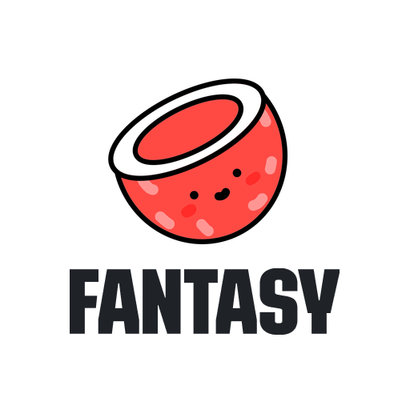
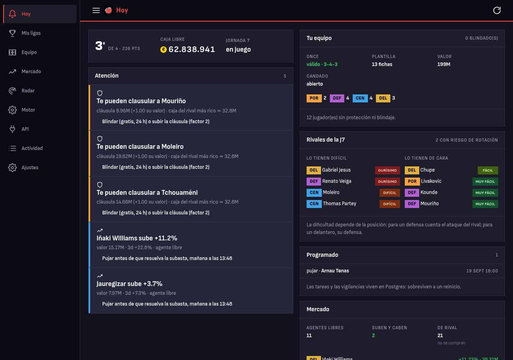
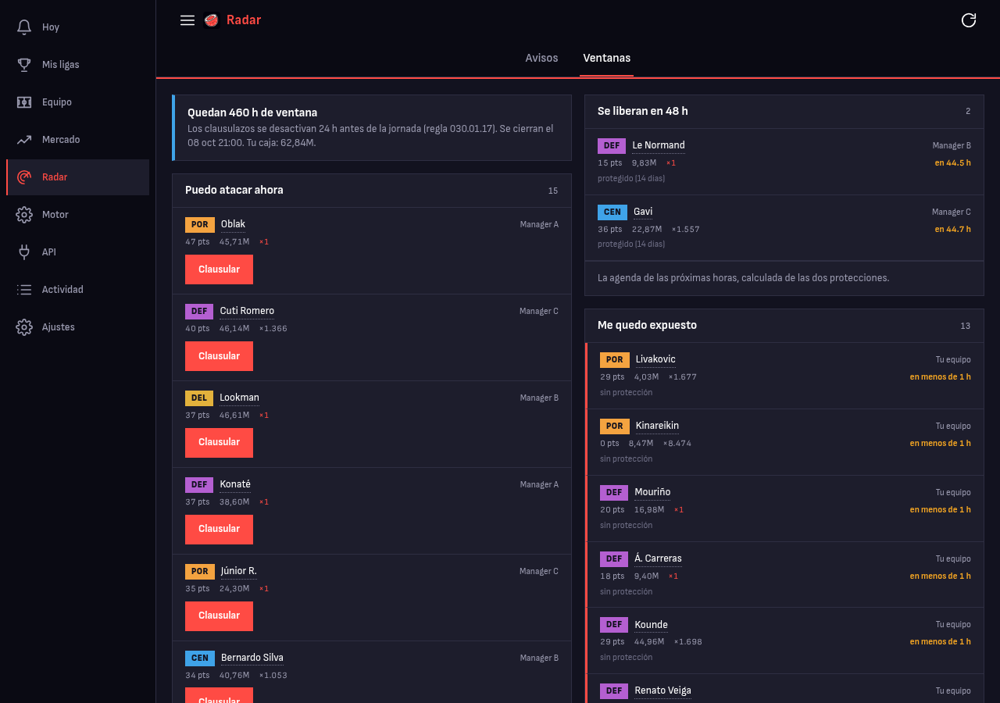
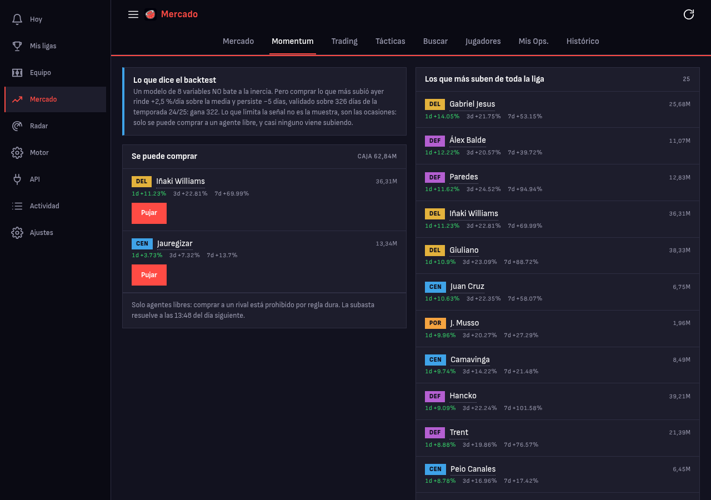
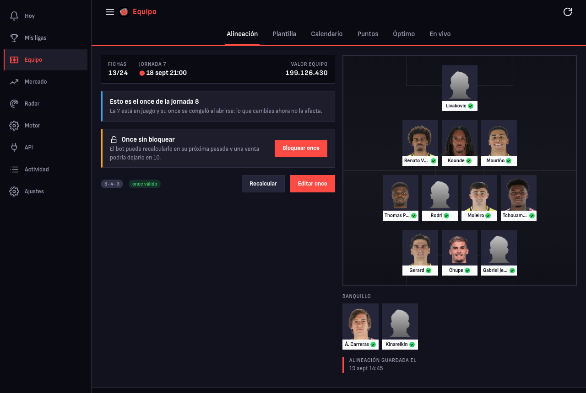
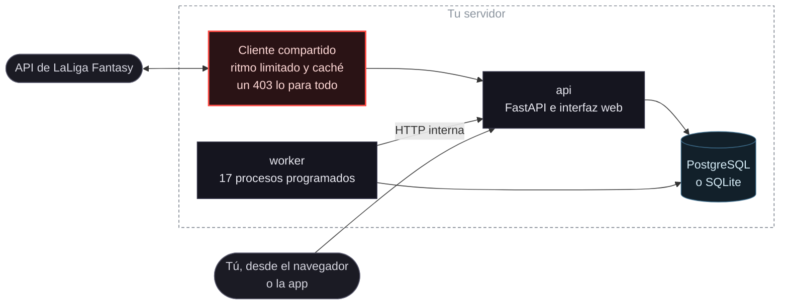

<div align="center">

<picture>
  <source media="(prefers-color-scheme: dark)" srcset="web/img/logo-transparente.png">
  
</picture>

# LaLiga Fantasy Coconut

**Análisis y automatización para LaLiga Fantasy, en tu propio servidor.**

Se conecta a la API del juego, acumula su propia serie de precios y convierte los datos en decisiones concretas: qué once alinear, a quién fichar, qué cláusula subir y a qué hora se abre cada ventana.

<p>      </p>

[Instalación](#-instalación) · [Qué hace](#-qué-hace) · [Cómo funciona](#%EF%B8%8F-cómo-funciona) · [Documentación](#-documentación) · [Antes de usarlo](#%EF%B8%8F-antes-de-usarlo)

</div>

---

## 👋 Qué es

LaLiga Fantasy se juega mirando la app cuando te acuerdas. Coconut la vigila por ti: habla con la API real del juego, guarda su propio histórico de precios, cruza lo que sabe y **te dice qué hacer hoy, ordenado por lo que cuesta no hacerlo**.

Sirve igual en una liga pública que en una privada con amigos. Corre en un contenedor Docker, se maneja desde el móvil y también puede funcionar entera dentro del teléfono. **No usa APIs de pago ni servicios en la nube.**

<div align="center"></div>

---

## ⚡ Instalación

```bash
docker volume create coconut-datos
docker run -d --name coconut -p 8140:8000 -v coconut-datos:/data ghcr.io/jesus33lcc/laliga-fantasy-api
```

Abre **`http://localhost:8140/app/`**. No hace falta ninguna credencial para empezar: el maestro de jugadores de LaLiga es público, así que hay datos y precios desde el primer arranque. Conectar tu cuenta solo hace falta para ver **tu** equipo.

> [!IMPORTANT]
> **El contenedor se niega a arrancar sin volumen.** La serie de precios se toma cuatro veces al día y no se puede reconstruir hacia atrás con esa resolución. Sin volumen desaparece entera en el primer `docker rm`.

Docker Compose, una base de datos propia o la app de Android: **[docs/INSTALACION.md](docs/INSTALACION.md)**.

---

## 🧰 Qué hace

### 🎯 Te dice a quién te pueden quitar, y cuándo

Las dos protecciones del juego, los 14 días del recién fichado y el blindaje de 24 h, vencen a **una hora concreta y conocida**. Coconut calcula la agenda de la liga entera: a quién puedes atacar, quién te puede atacar a ti y a qué hora se abre cada ventana.

<div align="center"></div>

### 📈 Sigue el precio

El valor de mercado se recalcula cada día y **tiene inercia**. Comprar lo que sube es dinero sin riesgo deportivo, y más presupuesto es más margen para clausular.

> [!NOTE]
> Medido sobre la temporada 24/25 completa (197.041 observaciones): los jugadores que más subieron ayer rinden **+2,47 % al día** sobre la media y la baten **322 días de 326**. El límite está en las ocasiones: entre los agentes libres, que son los únicos que se compran seguro, salen unas 1,5 por semana.

<div align="center"></div>

### ⚽ Alinea solo, y repara si te roban

Prueba las 7 formaciones con los puntos esperados de cada jugador y su probabilidad de ser titular. Si un rival te clausula a un titular, **sustituye solo ese hueco** antes de que el once se congele: un once de 10 anula la jornada entera.

<div align="center"></div>

### Y además

| | |
|---|---|
| 💰 **Caja de los rivales** | Deducida del tablón por partida doble. Contrastada contra una cifra que dio el propio rival: **0,7 % de error sobre 84 M** |
| ⏰ **Acciones programadas** | Una puja o un blindaje preparados para una hora concreta. Sobreviven a un reinicio |
| 👁️ **Vigilancias** | Siguen una operación hasta que termina: una venta hasta que entra la oferta, una protección hasta que cae |
| 🔔 **Avisos por Telegram** | Interruptor por categoría, umbral en euros y silencio nocturno |
| 🗄️ **Copia de seguridad** | A un repositorio privado tuyo, con historial y **sin ninguna credencial dentro** |
| 📱 **App Android** | La misma interfaz, y si quieres Coconut entero dentro del teléfono |

---

## 🏗️ Cómo funciona



**El riesgo que manda en el diseño es que LaLiga cierre la cuenta.** Por eso todas las peticiones salen por un único cliente con ritmo limitado, que respeta el `Cache-Control` que declara la propia API y **se para en seco ante un 403**: reintentar un 403 es lo que convierte un bloqueo temporal en permanente. El ritmo por defecto es la mitad del que se autoimpone el cliente oficial, que es 1 petición por segundo.

De ahí salen las decisiones que más se notan en el código: un solo cliente aunque haya dos procesos, **cero reintentos en las escrituras** porque no son idempotentes, y un interruptor de parada que funciona aunque falle todo lo demás.

### Un día en tu servidor

```mermaid
gantt
    title Horarios por defecto, configurables desde la interfaz
    dateFormat HH:mm
    axisFormat %H:%M
    todayMarker off
    section LaLiga
        Recálculo de valores        :milestone, 00:15, 0m
        Ciclo del mercado           :crit, milestone, 13:48, 0m
    section Vigilar
        Liga, plantillas y tablón cada 30 min :active, 00:00, 24h
        Centinela de clausulazos cada 10 min  :active, 00:00, 24h
        Guardia del once cada hora            :active, 00:00, 24h
    section Recoger
        Precios                     :milestone, 00:20, 0m
        Precios                     :milestone, 08:30, 0m
        Precios                     :milestone, 14:30, 0m
        Precios                     :milestone, 20:30, 0m
        Onces probables             :milestone, 09:40, 0m
        Onces probables             :milestone, 19:40, 0m
        Puntos por jornada          :milestone, 04:10, 0m
        Puntos por jornada          :milestone, 16:10, 0m
    section Actuar
        Recompensa diaria           :milestone, 09:07, 0m
        Alineación                  :milestone, 10:15, 0m
        Alineación                  :milestone, 18:15, 0m
        Alineación                  :milestone, 20:15, 0m
        Momentum del mercado nuevo  :milestone, 13:52, 0m
```



La hora del ciclo del mercado, cuando se resuelven las pujas y sale la baraja nueva, la marca cada liga; la de arriba es la de la liga en la que se desarrolló Coconut. Además de estas pasadas fijas, el once se guarda **12 minutos antes de que abra cada jornada**, abra a la hora que abra.

---

## 📚 Documentación

| | |
|---|---|
| 🚀 **[Instalación](docs/INSTALACION.md)** | Docker, Compose, base de datos propia, la app de Android y cómo conectar tu cuenta |
| 🏛️ **[Arquitectura](docs/ARQUITECTURA.md)** | Cómo está organizado el código, qué patrones usa y **dónde se queda corto** |
| 📖 **[Reglas del juego](docs/REGLAS.md)** | Las reglas que importan para jugar bien, con enlace a la fuente oficial y lo que la API demuestra distinto |
| 🧾 **[Errores de LaLiga](docs/ERRORES-API.md)** | 95 códigos de error con su significado. Varias reglas solo se conocen así |
| 🔌 **[API de Coconut](docs/API.md)** | Todas las operaciones, generadas del OpenAPI |
| 🗺️ **[Endpoints de LaLiga](docs/RUTAS-LALIGA.md)** | Las rutas conocidas de la API del juego y en qué estado está cada una |
| 🔬 **[Dónde está la ventaja](docs/analisis/ESTRATEGIA.md)** | Qué señales se han medido de verdad y cuáles no aportan |
| 🛡️ **[Seguridad](SECURITY.md)** | Qué credenciales maneja, dónde viven y cómo avisar de un fallo |

La documentación interactiva de la API está en **`/docs`** de tu propia instalación.

> [!NOTE]
> La API de LaLiga Fantasy **no está documentada públicamente**. Todo lo que aquí se afirma de ella está comprobado contra la API real, y cada ruta dice en qué estado está: usada, sin probar o dependiente de Premium.

---

## ⚠️ Antes de usarlo

> [!WARNING]
> **Buena parte del proyecto está escrita con ayuda de herramientas de IA.** Está probado contra la API real y el repositorio trae sus herramientas de verificación, pero puede haber errores incluso donde el código parece seguro de sí mismo. **Revisa lo que hace antes de fiarte, sobre todo en lo que mueve dinero.**

- **No es una aplicación oficial** ni está asociada a LaLiga. LaLiga, LaLiga Fantasy y sus marcas pertenecen a sus dueños.
- **Usa una API no documentada**, que puede cambiar sin aviso a mitad de temporada.
- **Gestiona una sola liga.** La liga se fija en la configuración y ni la base de datos ni los procesos separan por liga: si cambias la configurada, los datos de las dos se mezclan sin avisar.
- **Ninguna operación con dinero se ejecuta sin tu autorización.** El sistema propone; la decisión es tuya.
- **Tus credenciales las gestiona LaLiga.** Coconut nunca ve tu contraseña, y el token vive solo en tu disco.
- Se ofrece **tal cual, sin garantía**. Las recomendaciones son estimaciones sobre datos públicos.

---

<div align="center">

Hecho por **Jesús Luis Condori Chambi** · [github.com/jesus33lcc](https://github.com/jesus33lcc) · Licencia [MIT](LICENSE)

</div>
