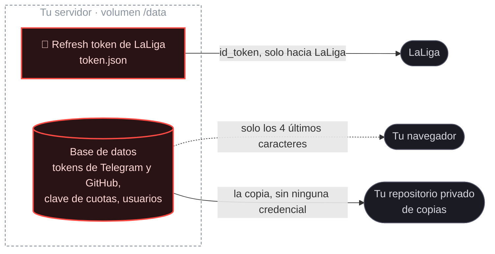

# Seguridad

## Avisar de un fallo

Si encuentras algo que compromete cuentas o datos, **no abras un issue público**. Usa **Security → Report a vulnerability** en este repositorio: el aviso llega solo a quien lo mantiene.

Para todo lo demás, como que algo se rompa o que LaLiga cambie una ruta, abre un issue normal.

---

## Qué credenciales maneja, y dónde viven

| | |
|---|---|
| **Token de LaLiga** | Un *refresh token* obtenido con OAuth y PKCE. **Opera tu equipo sin contraseña y sin segundo factor**, así que es la credencial más sensible. Vive en el volumen de datos y **no sale de ahí** salvo hacia LaLiga |
| **Tu contraseña de LaLiga** | **Coconut no la ve nunca, y no puede.** El inicio de sesión ocurre en la página oficial de LaLiga; aquí solo llega el código de autorización |
| **Tokens de Telegram y GitHub, clave de cuotas** | En la base de datos. **Nunca vuelven enteros al navegador**: la interfaz solo recibe los cuatro últimos caracteres |

> [!IMPORTANT]
> **La copia de seguridad deja fuera todas las credenciales**: el token de LaLiga, los de Telegram y GitHub, la clave de cuotas y los usuarios de Coconut. Restaurar pide volver a ponerlos. Es un minuto, y a cambio una copia filtrada no sirve para nada.

---

## Decisiones de diseño que son de seguridad

- **Ninguna credencial baja al navegador.** La web se sirve desde el mismo origen que la API, así que no hay CORS que configurar ni claves que repartir.
- **El puente hacia LaLiga solo admite GET, y con lista blanca de rutas.** Un proxy que dejara escribir permitiría pujar saltándose los topes de gasto y los locks.
- **Las escrituras no se reintentan.** No son idempotentes: reintentar una puja la duplica.
- **Un 403 detiene el sistema en seco.** Puede venir del WAF, y reintentar es lo que convierte un bloqueo temporal en permanente. Reactivar exige comprobar antes, con una sola petición, que el bloqueo no sigue.
- **Interruptor de parada** (`COCONUT_STOP` o el fichero `/data/STOP`) que corta toda petición saliente aunque falle todo lo demás.
- **Doble confirmación desde 10 M:** hay que repetir el importe. Protege de teclear un cero de más.
- **Inicio de sesión propio, opcional** (`COCONUT_AUTH=1`), con *scrypt*, cookie `HttpOnly` y los tokens de sesión guardados con hash.

---

## Si vas a desplegarlo

> [!CAUTION]
> **Coconut no está pensado para exponerse a internet.** No tiene límite de peticiones propio, ni protección contra fuerza bruta, ni HTTPS.

Ponlo detrás de una **VPN** o en tu red local. Si de verdad necesitas acceder desde fuera, pon delante un proxy inverso con TLS y activa `COCONUT_AUTH=1`.

Por eso el `docker-compose.publicado.yml` publica el puerto solo en `127.0.0.1` y no en `0.0.0.0`.
