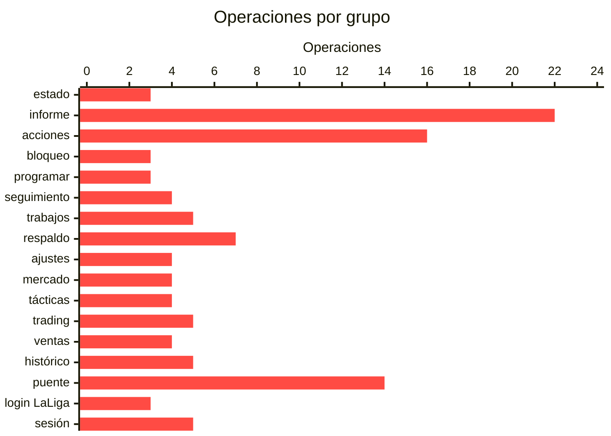

# La API de Coconut

> [!NOTE]
> Generado del `openapi.json` con `scripts/generar_docs_api.py`. **No se edita a mano**: si una ruta no está aquí, no existe. CI comprueba que esté al día.

**111 operaciones** en 17 grupos. La versión interactiva, con el esquema de cada respuesta y un botón para probarla, está en **`/docs`** de tu propia instalación.

## Antes de empezar

- Todo es **relativo a tu servidor**: `http://TU_SERVIDOR:8140`.
- Las lecturas no necesitan nada.
- **Las seis acciones que mueven dinero exigen `confirmar: true`** en el cuerpo, salvo con `COCONUT_MODO=real`: `pujar`, `ofertar`, `clausulazo`, `subir-clausula`, `venta-inmediata` y `aceptar-oferta`. Las dos últimas cobran en vez de gastar, y lo piden igual porque el jugador se va. Las demás escrituras no lo piden: ni mueven dinero ni son irreversibles.
- Desde 10 M hay que repetir el importe en `importe_confirmado`. Protege del cero de más.
- **`?dry=true`** devuelve lo que haría la operación sin tocar nada. Lo aceptan todas las acciones menos `fijar-once` (en POST y en DELETE) y `resolver`, que no llaman a LaLiga.
- Un rechazo de LaLiga vuelve **con su propio código** (400, 409, 423), no como un 500: una regla del juego no es una avería. Los códigos de LaLiga están en [ERRORES-API.md](ERRORES-API.md).

## Índice

| grupo | operaciones | para qué |
|---|:---:|---|
| [estado](#estado) | 3 | La foto operativa y la salud del sistema |
| [informe](#informe) | 22 | Lo que el sistema ha deducido: exposición, ventanas, momentum, saldos estimados |
| [acciones](#acciones) | 16 | Ejecutan operaciones reales |
| [bloqueo](#bloqueo) | 3 | El candado del once: impide que nada (ni el modelo ni una venta) rompa una alineación que has decidido a mano |
| [programar](#programar) | 3 | Dejar una acción lista para una hora concreta |
| [seguimiento](#seguimiento) | 4 | Vigilancias de larga duración: miran hasta que algo pasa, o caduca |
| [trabajos](#trabajos) | 5 | Los procesos automáticos: qué hacen, cuándo y con qué configuración |
| [respaldo](#respaldo) | 7 | Copia de seguridad a un repositorio privado y quién opera si hay varios dispositivos |
| [ajustes](#ajustes) | 4 | Qué avisos llegan al móvil, con cuánto ruido y por qué canal |
| [mercado](#mercado) | 4 | Filtrar el mercado de hoy, y guardar la búsqueda para que avise sola cuando salga la baraja del día |
| [tácticas](#tácticas) | 4 | Jugadas de mercado medidas, cada una con su muestra al lado |
| [trading](#trading) | 5 | Comprar para revender |
| [ventas](#ventas) | 4 | Qué hacer cuando llegue una oferta por un jugador tuyo, decidido ANTES de listarlo |
| [histórico](#histórico) | 5 | Consultas sobre la serie de precios que acumula tu propia instalación |
| [puente](#puente) | 14 | Paso directo a la API de LaLiga por el cliente compartido, para no abrir un segundo canal con su propio ritmo de peticiones |
| [login LaLiga](#login-laliga) | 3 | Conectar la cuenta por PKCE |
| [sesión](#sesión) | 5 | La sesión de Coconut, que no es la de LaLiga |

---

## estado

La foto operativa y la salud del sistema. Es por donde se empieza.

| | ruta | qué hace |
|---|---|---|
| `GET` | `/estado` | Foto operativa: caja, plantilla, jornada y sistema |
| `GET` | `/health` | Salud e invariantes de datos: 503 si algo falla |
| `POST` | `/salud/reactivar` | Reactivar Circuito |

---

## informe

Lo que el sistema ha deducido: exposición, ventanas, momentum, saldos estimados. Es donde vive el análisis.

| | ruta | qué hace |
|---|---|---|
| `GET` | `/informe` | El barrido completo de la rutina diaria |
| `GET` | `/informe/backtest` | ¿Acierta el sistema? Predicciones liquidadas |
| `GET` | `/informe/calendario-dificultad` | Contra quién juega cada uno tuyo, y cuánto duele |
| `GET` | `/informe/clasificacion/{jornada}` | Clasificación de una jornada concreta |
| `GET` | `/informe/en-vivo` | Puntos en vivo de la jornada |
| `GET` | `/informe/enfrentamientos` | Rival de cada jugador, duelos internos y avisos |
| `GET` | `/informe/equipo/{team_id}` | La plantilla y el once de cualquier manager |
| `GET` | `/informe/exposicion` | Quién me pueden quitar, con caja rival |
| `GET` | `/informe/hoy` | Qué hacer hoy, ordenado por urgencia |
| `GET` | `/informe/jornada` | Puntos, once congelado y si la jornada está contando |
| `GET` | `/informe/jugador/{player_id}` | Ficha completa: puntos por concepto y precio |
| `GET` | `/informe/mercado` | Agentes libres analizados (marca entrenadores) |
| `GET` | `/informe/mercado-historico` | A qué precio se vende de verdad en esta liga |
| `GET` | `/informe/mis-ofertas` | Ofertas recibidas por mis jugadores |
| `GET` | `/informe/momentum` | Qué sube, y qué de eso se puede comprar |
| `GET` | `/informe/optimo/{jornada}` | Tu once contra el más rentable de la jornada |
| `GET` | `/informe/premium` | ¿Es premium esta liga? Y qué cambiaría si lo fuera |
| `GET` | `/informe/saldos` | Cuánta caja tiene cada manager (estimada del tablón) |
| `GET` | `/informe/validar-once` | ¿El once actual es legal y completo? |
| `GET` | `/informe/ventana-blindaje` | ¿Se puede blindar, cuándo conviene y a quién? |
| `GET` | `/informe/ventana-clausulazo` | ¿Se puede clausular ahora, y hasta cuándo? |
| `GET` | `/informe/ventanas-liga` | A qué hora se puede atacar a quién, en toda la liga |

---

## acciones

Ejecutan operaciones reales. Las seis que mueven dinero exigen `confirmar: true` y pasan por los límites de gasto.

| | ruta | qué hace |
|---|---|---|
| `POST` | `/accion/aceptar-oferta` | Cobra una oferta por un jugador tuyo ya listado |
| `POST` | `/accion/alineacion` | Guarda el once (automático o a mano) |
| `POST` | `/accion/blindar` | Blinda a un jugador propio (24 h) |
| `POST` | `/accion/cancelar-puja` | Retira una puja viva por un agente libre |
| `POST` | `/accion/clausulazo` | Paga la cláusula de un jugador rival |
| `POST` | `/accion/fijar-once` | Fija un once para una jornada (manda sobre el modelo) |
| `DELETE` | `/accion/fijar-once` | Suelta el once fijado: vuelve a decidir el modelo |
| `POST` | `/accion/ofertar` | Oferta por un jugador que vende otro manager |
| `POST` | `/accion/pujar` | Puja por un AGENTE LIBRE |
| `POST` | `/accion/rechazar-oferta` | Rechaza una oferta recibida |
| `POST` | `/accion/recompensa` | Cobra la recompensa diaria (100.000 €) |
| `GET` | `/accion/resolver/{nombre}` | Busca un jugador por nombre (sin ejecutar nada) |
| `POST` | `/accion/retirar-mercado` | Quita del mercado un jugador que listaste |
| `POST` | `/accion/subir-clausula` | Sube la cláusula de un jugador propio |
| `POST` | `/accion/vender` | Lista a un jugador propio en el mercado |
| `POST` | `/accion/venta-inmediata` | Vende YA, sin esperar oferta (paga el 50 % del valor) |

---

## bloqueo

El candado del once: impide que nada (ni el modelo ni una venta) rompa una alineación que has decidido a mano.

| | ruta | qué hace |
|---|---|---|
| `GET` | `/bloqueo` | ¿Hay algún candado puesto? |
| `POST` | `/bloqueo/once` | Echar el candado al once |
| `DELETE` | `/bloqueo/once` | Abrir el candado del once |

---

## programar

Dejar una acción lista para una hora concreta. Sobrevive a reinicios.

| | ruta | qué hace |
|---|---|---|
| `POST` | `/programar` | Programa una acción para una hora futura |
| `GET` | `/programar` | Tareas programadas y su estado |
| `DELETE` | `/programar/{tid}` | Cancela una tarea pendiente |

---

## seguimiento

Vigilancias de larga duración: miran hasta que algo pasa, o caduca.

| | ruta | qué hace |
|---|---|---|
| `GET` | `/seguimiento` | Vigilancias activas y su historial |
| `POST` | `/seguimiento` | Crear una vigilancia |
| `GET` | `/seguimiento/sugerencias` | Qué vigilancias tendría sentido crear hoy |
| `DELETE` | `/seguimiento/{sid}` | Cancelar una vigilancia |

---

## trabajos

Los procesos automáticos: qué hacen, cuándo y con qué configuración.

| | ruta | qué hace |
|---|---|---|
| `GET` | `/trabajos` | Estado de los trabajos del worker |
| `GET` | `/trabajos/config` | Catálogo y configuración de cada proceso |
| `PUT` | `/trabajos/config/{nombre}` | Guardar la configuración de un proceso |
| `GET` | `/trabajos/{nombre}` | Historial de un trabajo |
| `POST` | `/trabajos/{nombre}/lanzar` | Lanzar un trabajo a mano |

---

## respaldo

Copia de seguridad a un repositorio privado y quién opera si hay varios dispositivos.

| | ruta | qué hace |
|---|---|---|
| `POST` | `/respaldo/copiar` | Sube la copia ahora |
| `GET` | `/respaldo/estado` | Qué se copia, cuándo fue la última y cuánto ocupa |
| `GET` | `/respaldo/mando` | Qué dispositivo es el que actúa |
| `POST` | `/respaldo/mando` | Este dispositivo pasa a ser el que actúa |
| `DELETE` | `/respaldo/mando` | Dejar el mando libre |
| `POST` | `/respaldo/probar` | ¿Sirven el token y el repositorio? No guarda nada |
| `POST` | `/respaldo/restaurar` | Trae la copia del repositorio y la mete |

---

## ajustes

Qué avisos llegan al móvil, con cuánto ruido y por qué canal. Se aplican en 15 segundos, sin reiniciar nada.

| | ruta | qué hace |
|---|---|---|
| `GET` | `/ajustes` | Ajustes actuales y catálogo de avisos |
| `PUT` | `/ajustes` | Guardar ajustes (fusiona: lo que no mandes no se borra) |
| `POST` | `/ajustes/probar` | Mandar un mensaje de prueba SIN guardar nada |
| `POST` | `/ajustes/probar-odds` | Comprobar la clave de the-odds-api SIN guardarla |

---

## mercado

Filtrar el mercado de hoy, y guardar la búsqueda para que avise sola cuando salga la baraja del día.

| | ruta | qué hace |
|---|---|---|
| `GET` | `/mercado/avisos` | Búsquedas guardadas que se revisan en cada mercado |
| `POST` | `/mercado/avisos` | Guardar una búsqueda para que avise sola |
| `DELETE` | `/mercado/avisos/{nombre}` | Quitar una búsqueda guardada |
| `GET` | `/mercado/buscar` | Filtrar el mercado de ahora mismo |

---

## tácticas

Jugadas de mercado medidas, cada una con su muestra al lado. Todas PROPONEN: ninguna ejecuta.

| | ruta | qué hace |
|---|---|---|
| `GET` | `/tacticas` | El catálogo: qué tácticas hay y qué hace cada una |
| `GET` | `/tacticas/clausulas-baratas` | T2 · Dónde sale rentable subir la cláusula |
| `GET` | `/tacticas/escaparate` | T1 · A quién listar para recoger la oferta buena |
| `GET` | `/tacticas/rivales` | T3 · Qué táctica de mercado usa cada rival |

---

## trading

Comprar para revender. Incluye el retorno REALIZADO, que es lo que dice si la señal sigue funcionando.

| | ruta | qué hace |
|---|---|---|
| `GET` | `/trading/balance` | ¿Esto funciona de verdad? Retorno REALIZADO |
| `GET` | `/trading/cartera` | Posiciones de trading abiertas |
| `GET` | `/trading/oportunidades` | Qué comprar hoy para revender (propuesta) |
| `POST` | `/trading/registrar` | Anota una compra hecha como operación de trading |
| `POST` | `/trading/{op_id}/estado` | Cambia el estado de una operación |

---

## ventas

Qué hacer cuando llegue una oferta por un jugador tuyo, decidido ANTES de listarlo. El modo por defecto cobra solo a partir de un 3 % de prima.

| | ruta | qué hace |
|---|---|---|
| `GET` | `/ventas` | Las políticas de venta guardadas, y los modos que existen |
| `GET` | `/ventas/{jugador}` | La política de un jugador (la suya o la de por defecto) |
| `PUT` | `/ventas/{jugador}` | Fijar la política de venta de un jugador |
| `DELETE` | `/ventas/{jugador}` | Quitar la política (vuelve a la de por defecto) |

---

## histórico

Consultas sobre la serie de precios que acumula tu propia instalación.

| | ruta | qué hace |
|---|---|---|
| `GET` | `/clausulas/exposicion` | Cuáles de los tuyos alcanza el rival más rico |
| `GET` | `/clausulas/objetivos` | A quién puedes clausular, del más barato por punto al más caro |
| `GET` | `/league/feed` | Tablón ya ingerido, con nombres resueltos |
| `GET` | `/market/movers` | Los que más se han movido de precio en 24 h |
| `GET` | `/players/{player_id}/history` | Serie de precio de un jugador, de tu propia instalación |

---

## puente

Paso directo a la API de LaLiga por el cliente compartido, para no abrir un segundo canal con su propio ritmo de peticiones. **Solo GET** y con lista blanca: un proxy de escrituras permitiría saltarse los límites.

| | ruta | qué hace |
|---|---|---|
| `GET` | `/fantasy/activity` | Tablón de la liga (TODAS las páginas) |
| `GET` | `/fantasy/calendar/{jornada}` | Los 10 partidos de una jornada |
| `GET` | `/fantasy/lineup` | Once actual (el que se congelará en la próxima jornada) |
| `GET` | `/fantasy/lineup/week/{jornada}` | Once CONGELADO de una jornada |
| `GET` | `/fantasy/market` | Mercado: agentes libres y fichas de rivales |
| `GET` | `/fantasy/money` | teamMoney + teamInvestment (solo del equipo propio) |
| `GET` | `/fantasy/offers/{player_team_id}` | Ofertas recibidas por un jugador propio |
| `GET` | `/fantasy/player/{player_id}` | Ficha con estadísticas POR JORNADA |
| `GET` | `/fantasy/players` | Maestro de jugadores con su valor de mercado |
| `GET` | `/fantasy/standing` | Clasificación |
| `GET` | `/fantasy/team/{team_id}` | Plantilla de un manager (con cláusulas) |
| `GET` | `/fantasy/teams` | Todas las plantillas + fixturePoints en UNA petición |
| `GET` | `/fantasy/week/current` | Jornada actual: apertura, cierre y si está viva |
| `GET` | `/puente/{ruta}` | Reenvía una ruta de LaLiga por el cliente compartido |

---

## login LaLiga

Conectar la cuenta por PKCE. LaLiga no expone ROPC, así que no hay forma de hacerlo con usuario y contraseña desde aquí.

| | ruta | qué hace |
|---|---|---|
| `POST` | `/auth/laliga/code` | Paso 2: pega la URL de vuelta (o el code) para conectar |
| `GET` | `/auth/laliga/estado` | ¿Está conectada la cuenta de LaLiga? |
| `GET` | `/auth/laliga/url` | Paso 1: URL para iniciar sesión con Google |

---

## sesión

La sesión de Coconut, que no es la de LaLiga. Con `COCONUT_AUTH=0` la VPN es la única puerta y esto no hace falta.

| | ruta | qué hace |
|---|---|---|
| `GET` | `/auth/google/inicio` | Empezar el login con Google |
| `POST` | `/auth/login` | Entrar con correo y contraseña |
| `POST` | `/auth/logout` | Cerrar esta sesión |
| `POST` | `/auth/logout-todo` | Cerrar la sesión en todos los dispositivos |
| `GET` | `/auth/yo` | Quién está dentro, y si hace falta estarlo |

