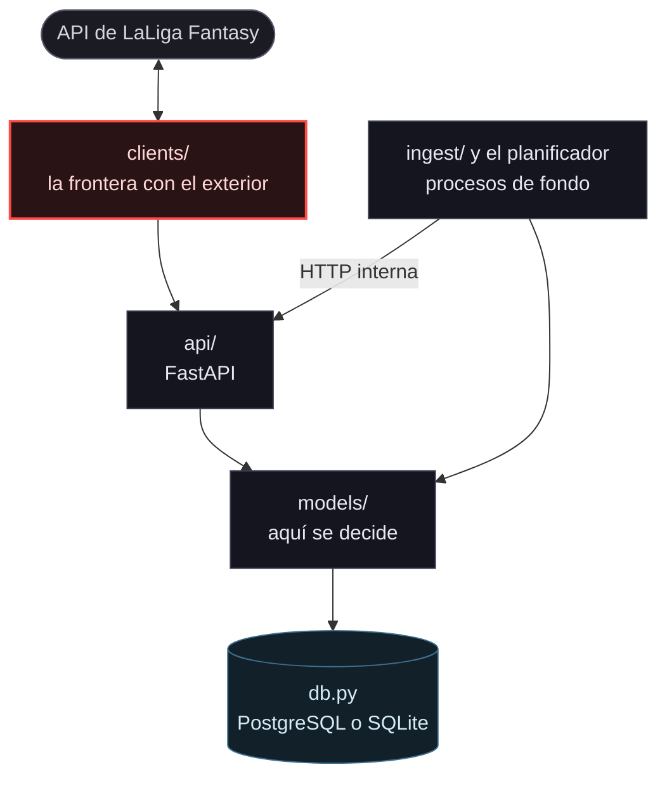
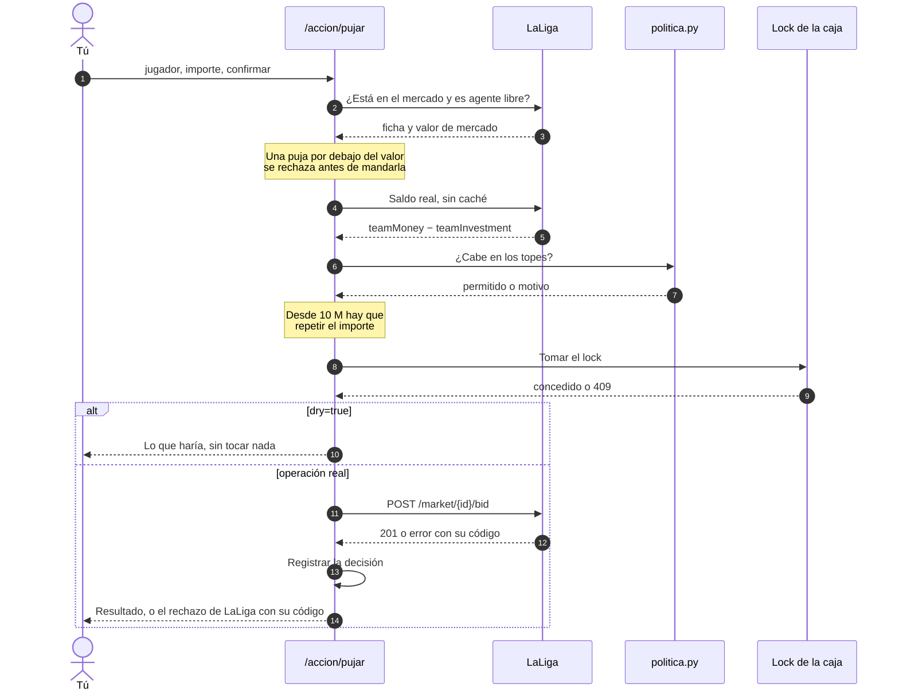
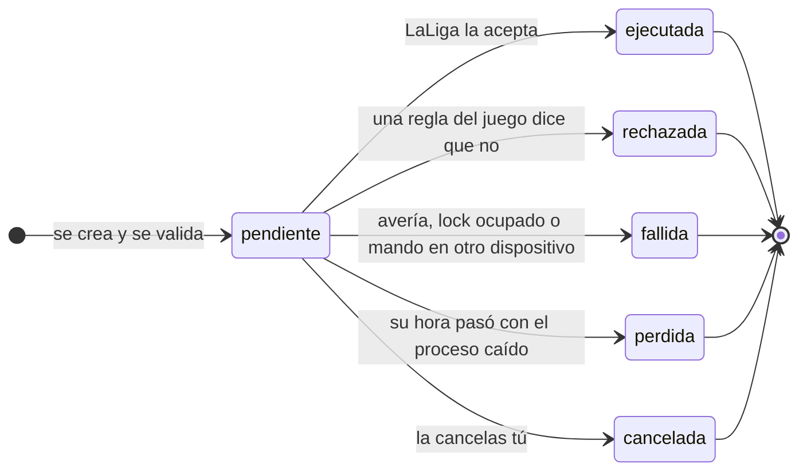
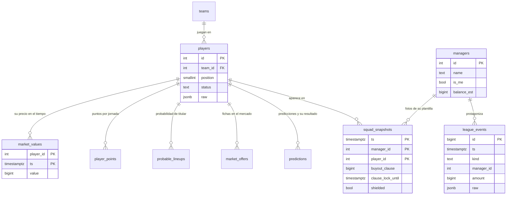
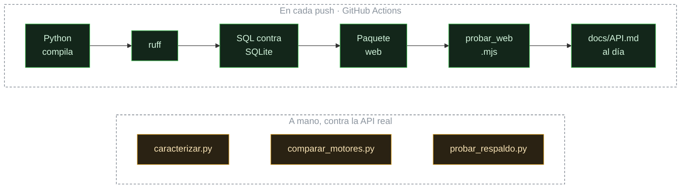

# Arquitectura

Cómo está organizado Coconut, qué patrones usa, qué principios cumple y **dónde se queda corto**. Las cifras están medidas y llevan su fecha.

**En esta página:** [El repositorio](#el-repositorio) · [Las capas](#las-capas) · [Una escritura con dinero](#una-escritura-con-dinero) · [Las tareas programadas](#las-tareas-programadas) · [Los datos](#los-datos) · [Los números](#los-números) · [Patrones](#patrones-y-por-qué-están) · [SOLID](#solid-dónde-se-cumple-y-dónde-no) · [Lo que no hay](#lo-que-no-hay-y-por-qué) · [Lo que está mal](#lo-que-está-mal) · [Cómo se verifica](#cómo-se-verifica)

---

## El repositorio

---

## Las capas

Cuatro capas con una sola dirección: **`api` y el planificador dependen de `models`, `models` depende de `db`, y nadie mira hacia arriba**. `clients/` es la frontera con el exterior y no conoce nada de dentro.

En la imagen publicada, el worker no habla con LaLiga por su cuenta: sus lecturas pasan por la API por HTTP interna, así que **hay un único cliente y un único límite de ritmo** aunque haya dos procesos. Lo activa `COCONUT_WORKER_VIA_API=1`, que la imagen pone por defecto. Si la API no responde, el worker cae al cliente directo para no perder una toma de precios.

---

## Una escritura con dinero

Toda operación que gasta sigue el mismo camino. Este es el de una puja, que es el más completo:

Tres reglas que no se negocian en ese camino:

- **Una escritura no se reintenta.** No es idempotente: reintentar una puja la duplica.
- **El saldo se lee de la API justo antes**, nunca de la base de datos, que va por detrás.
- **Un rechazo de LaLiga vuelve con su propio código** (400, 409, 423), no como un 500. Una regla del juego no es una avería.

---

## Las tareas programadas

Una acción programada vive en la tabla `tareas` y sobrevive a un reinicio. Estos son sus estados:

- **`rechazada` y `fallida` son distintas a propósito.** Un rechazo es el juego funcionando, no despierta a nadie y no se reintenta. Un fallo es algo que hay que arreglar y avisa.
- **Una tarea vencida con el proceso caído no se ejecuta tarde.** Una puja fuera de plazo o un clausulazo a destiempo hacen daño, así que queda como `perdida`.
- **La renovación de un blindaje respeta el cupo.** El cupo es de dos por jornada; si está gastado, la siguiente vuelta se aplaza hasta que vuelva, y entre medias el jugador está expuesto.

---

## Los datos

Las tablas que sostienen las decisiones, con sus relaciones:

`market_values` es la serie que **no se puede reconstruir hacia atrás**: LaLiga publica su histórico con un valor diario, y aquí se toman cuatro. Por eso la imagen se niega a arrancar sin volumen.

---

## Los números

| | | medido |
|---|---|---|
| Módulos Python en `src/` | **85** · 19.955 líneas | 3-nov-2026 |
| Bloques analizados (funciones, métodos y clases) | **653** | 3-nov-2026 |
| Complejidad ciclomática media | **5,5** | 3-nov-2026 |
| Bloques con complejidad ≤ 10 | **563 de 653** (86 %) | 3-nov-2026 |
| Bloques por encima de 30 | **10** · el mayor, 42 | 3-nov-2026 |
| Avisos de `ruff` en `src/` y `scripts/` | **0** | 3-nov-2026 |

Se repiten con `radon cc -s -a src` y `ruff check src scripts`, las dos dentro del contenedor y montando `pyproject.toml` (`-v "$PWD/pyproject.toml:/app/pyproject.toml:ro"`). El contenedor solo monta `src/` y `scripts/`: sin ese fichero, `ruff` corre con sus reglas por defecto y no con las del proyecto.

Los diez bloques por encima de 30 reúnen muchos casos de negocio en un sitio: las ventanas de toda la liga, las ofertas recibidas o el escaparate de ventas, entre otros. Partirlos repartiría una misma regla por varios ficheros.

---

## Patrones, y por qué están

### Cortacircuitos · `clients/http.py`

`ClienteEducado` se abre ante un 403 y **deja de emitir**, en vez de reintentar. Es un *circuit breaker* con un motivo propio: reintentar un bloqueo temporal es lo que lo convierte en permanente, y una cuenta cerrada deja el proyecto sin nada que leer. Se cierra a mano (`POST /salud/reactivar`) y solo después de comprobar con una petición que el bloqueo no era real.

### Registro de estrategias · `seguimiento.py` y `vigilantes.py`

Un decorador `@vigilante("nombre")` registra cada tipo de vigilancia, y **un solo bucle** los recorre. Añadir uno es escribir una función, sin tocar el bucle. Cada vigilante devuelve `("seguir" | "hecho" | "fallido", motivo, segundos)`: una máquina de estados pequeña y uniforme, cuyo estado vive entero en la base y sobrevive a un reinicio.

### Adaptador · `clients/via_api.py`

`ClienteViaAPI` tiene **la misma interfaz** que `ClienteEducado` pero enruta por la API. Los procesos no saben cuál usan: `cliente_lectura()` decide en un solo sitio, y cuenta cada vez que cae al cliente directo para que un respaldo permanente no pase desapercibido.

### Plantilla y catálogo · `catalogo_jobs.py` y `api/programar.py`

Cada proceso declara qué hace, cuánto cuesta en peticiones y qué se puede configurar, y la interfaz se dibuja **desde el catálogo**. La configuración se resuelve como «defecto del catálogo, pisado por lo guardado», así que cambiar un valor por defecto no pisa lo que eligió el usuario. Las acciones programables siguen la misma idea: una sola tabla de la que salen la validación, el ejecutor y el título del aviso.

### Aislamiento de bloques · `informe/comun.py:bloque()` y `ingest/vigilante.py`

Un panel hecho de piezas tiene un riesgo: que el fallo de una se lleve a las demás, o que una pieza desaparezca sin decirlo. Un panel sin «te pueden clausular a X» se lee igual que uno donde nadie puede robarte.

Cada pieza se ejecuta aislada, **deja rastro en el log** y, en el panel, **aparece diciendo que falta**. Se distingue además el fallo de programación (`NameError` y compañía, que sale con urgencia alta) del fallo del mundo (un tiempo de espera contra LaLiga, que no despierta a nadie).

### Guardián · `politica.py`

Todo lo que gasta pasa por `puede_gastar()`, y no hay un segundo camino. Lo sostiene la disciplina de que **toda escritura con dinero entre por `/accion/*`**, también las tareas programadas y el worker.

### Repositorio, a medias · `db.py`

`json_param()`, `ddl()` y `sqlite_compat` esconden las diferencias entre PostgreSQL y SQLite. **No es un Repositorio de libro**, porque el SQL sigue escrito en los módulos que lo usan, pero cumple su función: un solo sitio sabe que los dos motores no son iguales.

---

## SOLID: dónde se cumple y dónde no

| principio | | cómo |
|---|---|---|
| Responsabilidad única | ✅ mayormente | Capas con una dirección, y `api/informe/` partido en cinco módulos por dominio. Las funciones largas separan **obtener**, **decidir** y **presentar** |
| Abierto/cerrado | ✅ | Vigilantes, procesos, tácticas, tipos de actividad y acciones programables se extienden añadiendo una entrada, sin modificar el bucle que los recorre |
| Sustitución de Liskov | ➖ | Casi no hay herencia. Donde hay dos implementaciones de una interfaz (los dos clientes HTTP), son intercambiables |
| Segregación de interfaces | ➖ no aplica | El código son funciones y `dataclass`. No hay jerarquías que recorrer, y tampoco un punto único donde imponer un contrato |
| Inversión de dependencias | ✅ donde importa | `models/` no sabe si detrás hay PostgreSQL o SQLite, y los procesos no saben qué transporte usan. Son las dos fronteras que de verdad se mueven |

Separar las piezas sin entrada/salida tiene un beneficio concreto: son las que guardan las trampas de la API (que `weekNumber` apunta a la jornada siguiente, que `None` no es `0`, que hay dos protecciones distintas). Sueltas se leen de una vez y se prueban con una respuesta guardada, sin tocar la API.

> [!TIP]
> **Cómo se comprueba un reparto así:** no basta con que bajen las líneas. `scripts/caracterizar.py` captura la **forma** de la respuesta de cada endpoint (qué campos hay y de qué tipo), se hace el cambio y se compara. Compara forma y no valores porque los valores cambian solos: los precios se recalculan cada día.

---

## Lo que no hay, y por qué

| | por qué |
|---|---|
| **ORM** | Las consultas cruzan tablas de formas que un ORM complicaría, y el SQL neutro ya corre en los dos motores |
| **Framework en el navegador** | La interfaz son módulos ES y un empaquetador de 201 líneas que **aborta** ante una colisión de nombres. Nueve pantallas sin React |
| **Cola de mensajes** | La API y el worker se comunican por una tabla. Es una cola de un solo consumidor, que es lo que hace falta |
| **Redis** | La caché vive en el propio cliente HTTP, sembrada del `Cache-Control` que declara la API |
| **Modelo de precio complejo** | Uno de 8 variables **no bate a la inercia** (0 de 8 días evaluados), así que se usa la señal simple |

---

## Lo que está mal

### 🔴 Dos fuentes de verdad

**`models/` lee la base de datos, no la API**, y la base puede ir hasta una ingesta por detrás. El coste concreto: alinear a un jugador que ya te han clausulado. LaLiga acepta el once con un 200, lo descarta en silencio y lo deja en diez, que anula la jornada.

En la alineación, que es donde más cuesta, hay cuatro defensas:

1. **Antes de decidir**, si la foto de la plantilla pasa de 20 minutos se vuelve a ingerir la liga.
2. **Antes de escribir**, la comprobación de propiedad lee de la API sin caché.
3. **Después de escribir**, se relee el once y se cuentan 11. Si LaLiga descartó a alguien, la respuesta dice `ok: false` y salta una emergencia con su nombre.
4. **La guardia del once pregunta la propiedad a la API**, no a la base. Con una foto vieja, el jugador robado seguiría pareciendo tuyo y la guardia respondería «todo bien».

La arquitectura sigue permitiendo decidir con datos viejos, y se nota en `/informe/hoy`. Lo de arriba acota el daño donde más duele; no quita la causa.

### 🟠 El esquema vive en dos sitios

`db/001_schema.sql` declara 12 tablas y los módulos crean el resto al arrancar con `CREATE TABLE IF NOT EXISTS`. `db.asegurar_tablas()` las crea todas desde un sitio, que es lo que hace que una restauración sobre una base vacía funcione, pero el esquema sigue partido.

### 🟠 Una verificación puede apuntar al artefacto equivocado

`scripts/` se monta de solo lectura en el contenedor, así que una referencia guardada cae a `/data/` mientras la comparación lee la del repositorio. Está acotado: se compara siempre contra la del repositorio y guardar avisa de que hay que copiarla. Vale igual para el empaquetador de la web, que escribe donde se le diga: sin argumento es la única forma de probar el paquete que se sirve.

---

## Cómo se verifica

No hay tests unitarios, y es deliberado: **lo que falla aquí no es la aritmética**, es la forma de un dato de LaLiga o un botón que no hace nada.

| herramienta | qué caza |
|---|---|
| `scripts/caracterizar.py` | Cambios en la **forma** de 79 cosas: 60 endpoints de lectura y 19 funciones de dominio. Es la red de los refactors |
| `scripts/probar_web.mjs` | Pantallas que no renderizan y **acciones sin manejador** |
| `scripts/comparar_motores.py` | Que PostgreSQL y SQLite devuelvan lo mismo ejecutando funciones reales |
| `scripts/probar_respaldo.py` | Que una copia **se pueda restaurar** |
| `ruff` | El linter, con la configuración de `pyproject.toml` |
| `scripts/auditar_sql_sqlite.py` | Compila **todo** el SQL contra SQLite. Con `--esquema` no necesita datos ni credenciales, y por eso corre en CI |

> [!WARNING]
> La caracterización compara forma, no contenido. Una llamada que pierde su `import` y cae en un `except` genérico produce una respuesta con **la misma forma y el contenido falso**. Eso lo caza `ruff` con la regla `F821`, no la caracterización.
