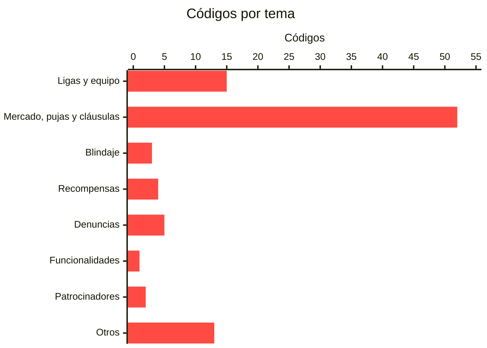

# Códigos de error de la API de LaLiga Fantasy

**95 códigos** con su significado. Cuando LaLiga rechaza una operación devuelve un `errorCode` como `030.01.29`, y el número por sí solo no dice nada. Esta página lo traduce.

Varias reglas del juego **no están escritas en ninguna parte** y solo se conocen por el error que devuelve LaLiga al romperlas. Leída entera, la lista hace de reglamento.

> [!NOTE]
> Un `errorCode` no es una avería: es el juego diciendo que la jugada no vale. Coconut lo devuelve con su propio código HTTP (400, 409, 423) en vez de convertirlo en un 500.

---

## Reglas que solo se conocen por su error

| código | regla |
|---|---|
| **`030.01.17`** | **Los clausulazos se desactivan 24 h antes de cada jornada** y vuelven cuando empieza. La ventana no está siempre abierta |
| **`030.01.32`** | **Se puede pujar en deuda, hasta el 20 % del valor de tu equipo.** Con saldo negativo al empezar una jornada no se puntúa; con la jornada ya en marcha, medido, no la anula |
| **`030.01.40`** | El máximo de 24 fichas **cuenta también las pujas y ofertas abiertas**, no solo la plantilla |
| **`030.02.03`** | Hay un **máximo de blindajes por jornada**: dos, que vuelven al cerrarse la jornada |
| **`030.01.14`** | No se puede subir una cláusula por encima de lo que permite tu saldo |
| **`020.01.16`** | Los ajustes de una liga Premium se congelan unas horas antes de cada jornada |

## Y las del reglamento, con su código

| código | regla |
|---|---|
| `030.01.16` | 14 días de protección al recién fichado |
| `030.01.31` | La puja debe ser igual o mayor que el **valor de mercado**, no que el precio de salida |
| `030.01.29` | El clausulazo, igual o mayor que la cláusula |
| `030.01.62` | Un jugador blindado no se puede clausular |
| `050.01.04` | Una recompensa diaria al día |
| `020.01.03` | Máximo 24 fichas |

> [!WARNING]
> **El texto que devuelve el servidor no siempre es el del cliente oficial.** Con el mismo código, `030.01.02`, la app dice «por debajo del valor de mercado» y el servidor responde que la cantidad no es válida para ese jugador. Ante una discrepancia manda el texto del servidor: es el que describe lo que ha pasado.

---

## Todos los códigos

Los mensajes son los del cliente oficial de Android, en inglés, tal cual vienen en él. `%s` y `%d` son huecos que la app rellena con un nombre o un número.

### Ligas y equipo · 15

| código | mensaje del cliente oficial |
|---|---|
| `020.01.01` | You already joined 5 leagues from this sponsor. |
| `020.01.02` | Wrong number of players. |
| `020.01.03` | Max. team players number reached (24). |
| `020.01.04` | Max. league teams number reached (16). |
| `020.01.05` | You already lineup this player in your lineup. |
| `020.01.06` | You already joined this league. |
| `020.01.07` | You were kicked out from this league. |
| `020.01.08` | The second round hasn't started yet. |
| `020.01.09` | You already joined %d private leagues from this sponsor. |
| `020.01.12` | The administrator has modified the league settings. Log in again to update the information. |
| `020.01.16` | You cannot modify the settings of a premium league %s hours before the start of fixture. |
| `020.01.23` | A coach cannot be selected as the captain of your team. |
| `020.01.33` | You cannot place a bid on this player right now, please try again later. |
| `020.01.34` | You cannot perform this action because the corresponding option is not enabled in this league. |
| `020.02.01` | Invalid league code. |

### Mercado, pujas y cláusulas · 52

| código | mensaje del cliente oficial |
|---|---|
| `030.01.01` | The operation cannot be completed because the amount selected is below the market value of %s |
| `030.01.02` | The operation cannot be completed because the selected amount is below the market value of %s |
| `030.01.03` | Player not present in market anymore. |
| `030.01.04` | Bidden money exceed the allowed indebtedness (20% from yor team value). |
| `030.01.05` | Max. number of players reached (squad players + current bids and offers). |
| `030.01.06` | Offer already accepted. |
| `030.01.07` | Offer already rejected. |
| `030.01.08` | This player doesn't belongs you anymore. |
| `030.01.09` | You already bidden for this player. |
| `030.01.10` | This bid has been accepted or rejected. |
| `030.01.11` | This bid has expired. |
| `030.01.12` | Invalid transfer |
| `030.01.14` | You don't have enough money to set such a high release clause |
| `030.01.15` | The operation cannot be completed because you have an insufficient balance. Please check it again |
| `030.01.16` | You can't pay this release clause for 2 weeks, because the player has just been assigned to this manager's team or has just been signed. |
| `030.01.17` | The payment of release clauses is deactivated 24h prior to a matchday. It will be available again as soon as the next matchday begins. |
| `030.01.18` | The operation cannot be performed because %s is no longer part of your squad |
| `030.01.19` | Sorry, the player you are trying to buy doesn't belongs to LALIGA anymore. |
| `030.01.22` | You have already made an offer for this player, refresh the info to view and edit it |
| `030.01.23` | Sorry, another manager has beaten you to it and signed this player before you |
| `030.01.24` | Sorry, it is not possible to perform the operation requested since the manager no longer belongs to this league |
| `030.01.26` | The operation cannot be performed because %s is no longer part of your squad |
| `030.01.27` | The operation cannot be performed because %1$s no longer belongs to the squad of %2$s. |
| `030.01.28` | The operation cannot be completed because you have an insufficient balance. Please check it again |
| `030.01.29` | The operation can't be completed. The offer should be equal or greater than the buyout clause of the player. |
| `030.01.30` | The operation cannot be performed. The bid has been rejected |
| `030.01.31` | The operation cannot be completed because the bid amount is below the market value of %s |
| `030.01.32` | The bid cannot be changed because it exceeds your permitted debt level (20% of the value of your team) |
| `030.01.33` | The amount cannot be less that the one indicated for this type of operation |
| `030.01.34` | The operation cannot be completed. Check the number of loan players or incomplete loan operations. |
| `030.01.35` | A loan offer already exists for this player. |
| `030.01.36` | The operation cannot be performed because %s is already on loan. |
| `030.01.37` | The operation cannot be completed. Check the number of loan players or incomplete loan operations. |
| `030.01.38` | The operation cannot be completed because you have reached the maximum number of loan players |
| `030.01.39` | The operation cannot be completed because the loan-request period has ended. You may perform the operation up to 24 hours before the start of a matchday. |
| `030.01.40` | Max. number of players reached (squad players + current bids and offers). |
| `030.01.41` | The operation cannot be performed because %s is no longer part of your squad |
| `030.01.42` | The operation cannot be completed because the offer was rejected. |
| `030.01.43` | The amount offered must be more than the previous amount. |
| `030.01.44` | The operation cannot be completed, the offer has been rejected |
| `030.01.45` | The operation cannot be completed, the offer has already been resolved. |
| `030.01.46` | The manager who owns %s no longer forms part of this league. The loan has been ended successfully, returning the player to the market. |
| `030.01.47` | The bidding cannot take place. This coach is out of league |
| `030.01.48` | The operation cannot be carried out because the offer has expired |
| `030.01.49` | It was not possible to complete the operation because no offers were found for this player |
| `030.01.50` | It was not possible to complete the operation because the offer was not found for this player |
| `030.01.51` | The selected player has been removed from the market |
| `030.01.52` | The selected player has been added to the market |
| `030.01.53` | The offer cannot be accepted because the amount has been changed |
| `030.01.54` | The player is no longer available in LALIGA. |
| `030.01.61` | An error was detected during operation due to an incorrect multiplication factor. Please try again |
| `030.01.62` | The operation cannot be performed because the player is already shielded. Stay tuned because it will be unlocked in a few hours. |

### Blindaje · 3

| código | mensaje del cliente oficial |
|---|---|
| `030.02.01` | The operation cannot be performed because the player is already shielded. |
| `030.02.02` | The operation cannot be performed because the player is already blocked, extending the time is not allowed. |
| `030.02.03` | The operation cannot be carried out because you have reached the maximum number of shields allowed on this fixture. |

### Recompensas · 4

| código | mensaje del cliente oficial |
|---|---|
| `050.01.01` | The operation could not be carried out because an error occurred while validating the reward obtained. |
| `050.01.02` | The operation is not available at this time. |
| `050.01.03` | An error has occurred while retrieving the daily reward configuration information |
| `050.01.04` | You have already reached the maximum number of daily rewards |

### Denuncias · 5

| código | mensaje del cliente oficial |
|---|---|
| `0100.03.01` | You can´t report yourself |
| `0100.03.02` | This report doesn´t exist |
| `0100.03.03` | You can´t report league administrator |
| `0100.03.04` | The user can't be reported because it has a pending report. |
| `0100.03.05` | To join in, you must change your region in the settings menu, and choose the correct region |

### Funcionalidades · 1

| código | mensaje del cliente oficial |
|---|---|
| `0102.01.01` | This functionality is not active at this time. |

### Patrocinadores · 2

| código | mensaje del cliente oficial |
|---|---|
| `0105.01.01` | You have joined this sponsor's LALIGA Fantasy |
| `0105.01.02` | Sorry, once the match has started, you can no longer join the event |

### Otros · 13

| código | mensaje del cliente oficial |
|---|---|
| `070.03.01` | Email is missing. |
| `070.03.02` | User not found. |
| `201.01.06` | This refund is already being processed. For now it is not possible to send it again. |
| `201.02.01` | Sorry! The product is no longer available. |
| `201.04.01` | Sorry! An error occurred while accessing the store. Please try again later. |
| `201.04.03` | Sorry! An error occurred while validating the receipt. Please try again later. |
| `202.01.01` | We are sorry! The validity date of the link has been reached and the link is invalid. |
| `202.01.02` | We are sorry! The parameters of the link used are invalid. |
| `202.01.03` | We are sorry! The link used is invalid because it has been deactivated. |
| `202.01.04` | We are sorry! This link has already been used to make a purchase. |
| `202.01.05` | An error has occurred in updating the purchase link information. |
| `301.01.03` | An error occurred while starting the login process. Please try again later. |
| `301.01.05` | There was an error updating your profile information. Please try again later. |
