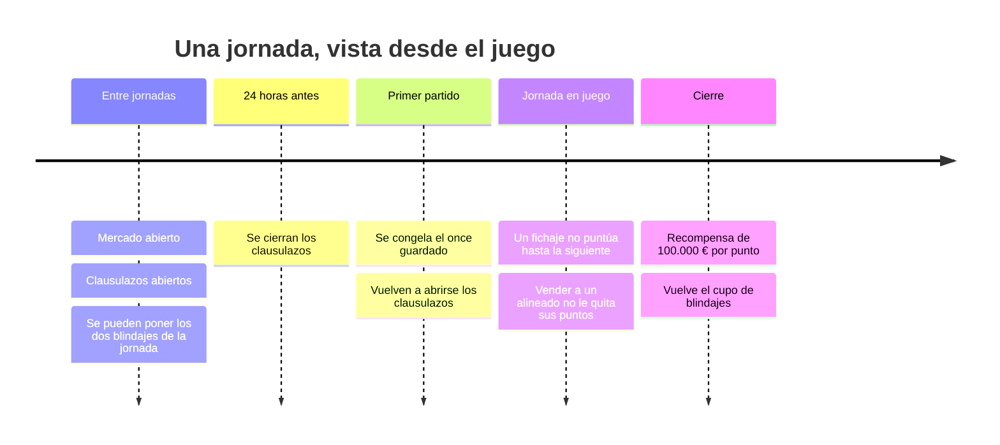
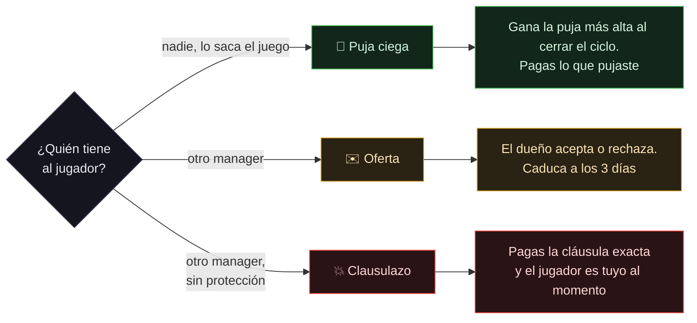

# Reglas del juego

Las reglas de LaLiga Fantasy que importan para jugar bien, resumidas por temas. Cada apartado enlaza al artículo del [centro de ayuda oficial](https://laligafantasy.zendesk.com/hc/es), que es la fuente. Al final está [lo que la API demuestra distinto](#lo-que-la-api-demuestra-distinto): reglas que el centro de ayuda no cuenta, o que cuenta de otra forma.

> [!NOTE]
> Esto es un resumen hecho para este proyecto, no el reglamento. Ante cualquier duda manda el [reglamento oficial](https://laligafantasy.zendesk.com/hc/es/articles/360025679853-Reglamento). Consultado el 3 de noviembre de 2026.

**En esta página:** [La jornada](#la-jornada) · [Plantilla y alineación](#plantilla-y-alineación) · [Puntuación](#puntuación) · [Mercado](#mercado) · [Cláusulas](#cláusulas) · [Blindaje](#blindaje) · [Saldo y deuda](#saldo-y-deuda) · [Ligas Premium](#ligas-premium) · [Lo que la API demuestra distinto](#lo-que-la-api-demuestra-distinto) · [Artículos oficiales](#artículos-oficiales)

---

## La jornada

- **Puntúa el once guardado justo antes del primer partido.** Lo que cambies después no afecta a esa jornada. LaLiga recomienda dejarlo listo media hora antes. [Fuente](https://laligafantasy.zendesk.com/hc/es/articles/115002390473--Qu%C3%A9-futbolistas-de-mi-equipo-suman-puntos-durante-la-jornada)
- **Para puntuar hacen falta 11 jugadores alineados y saldo positivo** en ese momento. Si falta cualquiera de las dos cosas, no se puntúa **ninguna** jugada de la jornada. [Fuente](https://laligafantasy.zendesk.com/hc/es/articles/360025541414--Qu%C3%A9-necesito-para-puntuar-cada-jornada)
- **Vender a un jugador alineado no le quita los puntos** de esa jornada, haya jugado ya o no. [Fuente](https://laligafantasy.zendesk.com/hc/es/articles/115002390753--Puedo-vender-un-futbolista-en-mitad-de-una-jornada)
- **Los clausulazos se cierran 24 horas antes de que empiece una jornada** y se reabren cuando empieza. [Fuente](https://laligafantasy.zendesk.com/hc/es/articles/360025683553--Qu%C3%A9-significa-pagar-una-cl%C3%A1usula)

---

## Plantilla y alineación

| | |
|---|---|
| **Plantilla** | Máximo 24 jugadores. Las pujas y ofertas que tengas abiertas también cuentan para ese tope. [Fuente](https://laligafantasy.zendesk.com/hc/es/articles/115002401934--Por-qu%C3%A9-no-puedo-hacer-una-oferta-o-una-puja-por-un-jugador) |
| **Formaciones** | 3-5-2 · 3-4-3 · 4-4-2 · 4-3-3 · 4-5-1 · 5-4-1 · 5-3-2. Las ligas Premium añaden más. [Fuente](https://laligafantasy.zendesk.com/hc/es/articles/115002390733--Puedo-jugar-con-cualquier-esquema-estrat%C3%A9gico) |
| **Lesionados y sancionados** | Se pueden alinear, pero no puntúan. Ocupan plaza y no anulan la jornada |
| **Empate en la clasificación** | Gana quien tenga más valor de equipo y, si sigue el empate, más saldo. [Fuente](https://laligafantasy.zendesk.com/hc/es/articles/115002401534-En-caso-de-empate-de-Puntos-Fantasy-Qui%C3%A9n-gana-una-jornada-o-competici%C3%B3n) |

> [!WARNING]
> **Un cambio de posición puede costarte la jornada entera.** Si LaLiga cambia de posición a un jugador que tienes alineado y tocas cualquier cosa del once, o alguien te ficha a un titular, la alineación se refresca y ese jugador queda fuera aunque la veas completa. Hay que vaciar su hueco y volver a colocarlo. [Fuente](https://laligafantasy.zendesk.com/hc/es/articles/6594850326162-Cambios-de-posici%C3%B3n-de-jugadores)

---

## Puntuación

Cada punto suma **100.000 €** a tu saldo al cerrar la jornada. [Fuente](https://laligafantasy.zendesk.com/hc/es/articles/115002390453--C%C3%B3mo-se-calculan-los-puntos-de-mi-equipo)

**Lo que depende de la posición:**

| | 🧤 POR | 🛡️ DEF | 🎯 MED | ⚡ DEL |
|---|:---:|:---:|:---:|:---:|
| Gol | +6 | +6 | +5 | +4 |
| Portería a cero, con más de 60 min | **+4** | **+3** | +2 | +1 |
| Goles encajados, cada 2 | −2 | −2 | −1 | −1 |
| Balones perdidos | −1 cada 8 | −1 cada 8 | −1 cada 10 | −1 cada 12 |

**Lo común a todos:**

| acción | puntos |
|---|---|
| Jugar menos de 60 min · más de 60 min | +1 · +2 |
| Asistencia de gol · asistencia sin gol | +3 · +1 |
| Penalti parado · provocado | +5 · +2 |
| Penalti fallado · cometido | −2 · −2 |
| Paradas, cada 2 | +1 |
| Tiros a puerta, regates logrados o balones al área, cada 2 | +1 |
| Balones recuperados, cada 5 · despejes, cada 3 | +1 · +1 |
| Amarilla · doble amarilla · roja | −1 · −1 · −3 |
| Nota DAZN, por estadística avanzada de Opta | de 0 a +4 |

> [!TIP]
> Para un portero, la portería a cero vale **+4** y además evita los −2 por cada dos goles encajados. Es el mayor bloque de la tabla, y por eso la probabilidad de portería a cero es la señal que más pesa al elegir porteros y defensas.

---

## Mercado

Hay tres formas de fichar, y solo una es segura:

- **Ninguna puja ni oferta puede quedar por debajo del valor de mercado.** El precio de salida que pone el vendedor no cuenta. [Fuente](https://laligafantasy.zendesk.com/hc/es/articles/115002401674--C%C3%B3mo-funciona-el-mercado-de-fichajes-de-LALIGA-FANTASY)
- **Las pujas son ciegas:** ves cuántas hay, no de cuánto ni de quién. Si dos empatan, gana la que se hizo primero. [Fuente](https://laligafantasy.zendesk.com/hc/es/articles/115002401974--C%C3%B3mo-puedo-ver-las-pujas-de-otros-usuarios-Por-qu%C3%A9-las-pujas-son-ciegas)
- **Si pones a un jugador a la venta, el propio juego te hace una oferta** por un importe al azar entre un 10 % por debajo y un 10 % por encima de su valor, renovada cada ciclo. Puedes aceptarla o esperar a la siguiente.
- **La venta inmediata paga el 50 % del valor** al momento. [Fuente](https://laligafantasy.zendesk.com/hc/es/articles/115002390653--Qu%C3%A9-es-la-venta-inmediata-de-un-jugador-de-mi-plantilla)
- **Un jugador que se va a otra liga se devalúa rápido.** LaLiga recomienda venderlo cuanto antes, sin venta inmediata. [Fuente](https://laligafantasy.zendesk.com/hc/es/articles/115002391153--Qu%C3%A9-pasa-si-un-jugador-es-vendido-en-la-vida-real-a-otra-liga-diferente-de-LALIGA)

---

## Cláusulas

| | |
|---|---|
| **Al fichar** | La cláusula queda en lo que pagaste, con un mínimo de 1 M |
| **Subirla** | Cuesta la mitad de lo que sube: subir 2 M cuesta 1 M |
| **Protección** | Durante **14 días** desde que llega a tu plantilla, nadie puede clausularlo. Sí pueden hacerte ofertas |
| **Pagarla** | Hay que tener el dinero en caja: no se puede uno endeudar ni para clausular ni para subir una cláusula |

[Fuente](https://laligafantasy.zendesk.com/hc/es/articles/360025683593--C%C3%B3mo-se-establecen-las-cl%C3%A1usulas) · [Fuente](https://laligafantasy.zendesk.com/hc/es/articles/360025679853-Reglamento)

---

## Blindaje

El blindaje **no aparece en ningún artículo del centro de ayuda**. Lo anunció LaLiga en su [web](https://www.laliga.com/en-GB/news/double-shield-arrives-in-laliga-fantasy), y el resto está comprobado contra la API:

| | |
|---|---|
| **Cupo** | **Dos por jornada.** Se renueva al cerrar la jornada, no a medianoche ni al caducar un blindaje |
| **Duración** | **24 horas** exactas desde que se pone |
| **Cuándo** | Solo entre el cierre de una jornada y la apertura de la siguiente, y solo sobre jugadores que ya no están en sus 14 días |
| **Efecto** | Un jugador blindado no se puede clausular: LaLiga lo rechaza con el error `030.01.62` |

> [!TIP]
> El blindaje dura 24 horas y la ventana de clausulazos puede durar días, así que el momento importa. Puesto en cuanto se puede, deja descubierto el final de la ventana; puesto 48 horas antes de la siguiente jornada, cubre justo hasta que se cierran los clausulazos.

---

## Saldo y deuda

- **Al empezar, cada manager recibe 100 M y una plantilla de 14 jugadores.** Quien recibe una plantilla por debajo de la media cobra además una compensación. [Fuente](https://laligafantasy.zendesk.com/hc/es/articles/360025679853-Reglamento)
- **Para pujar se puede deber hasta el 20 % del valor de tu plantilla.** Para clausular, no. [Fuente](https://laligafantasy.zendesk.com/hc/es/articles/360007533594--Puedo-quedarme-con-saldo-negativo-en-mi-presupuesto)
- **Con saldo negativo al empezar la jornada, no se puntúa.** [Fuente](https://laligafantasy.zendesk.com/hc/es/articles/115002391113--Qu%C3%A9-significa-estar-en-n%C3%BAmeros-rojos-o-con-saldo-negativo)

---

## Ligas Premium

Funciones que el administrador de una liga Premium puede activar. [Fuente](https://laligafantasy.zendesk.com/hc/es/articles/4414999058450-Ligas-premium) · [Entrenador](https://laligafantasy.zendesk.com/hc/es/articles/6607113048978-Entrenador) · [Cesiones](https://laligafantasy.zendesk.com/hc/es/articles/7416404956434-Cesiones)

| función | qué hace |
|---|---|
| **Capitán** | Puntúa doble si juega. Un entrenador no puede serlo |
| **Banquillo** | Hasta cuatro suplentes, uno por posición, que entran si el titular de su línea no juega |
| **Entrenador** | Hasta dos por plantilla. Puntúa 5 si su equipo gana, 2 si empata y 0 si pierde |
| **Cesiones** | Hasta tres jugadores cedidos, por una jornada cada vez |
| **Más formaciones** | 3-6-1 · 3-3-4 · 4-2-4 · 4-6-0 · 5-2-3 |

Coconut detecta qué funciones tiene activas tu liga y avisa si hay alguna que todavía no aprovecha.

---

## Lo que la API demuestra distinto

Reglas que el centro de ayuda no menciona o cuenta de otra forma, comprobadas contra la API real:

| tema | el centro de ayuda dice | la API demuestra |
|---|---|---|
| **La cláusula y el valor** | La cláusula es siempre el mayor entre el valor y la cláusula puesta | **No sube con el valor.** Un jugador comprado por 65 M mantuvo esa cláusula cinco semanas mientras su valor subía un 21 %. Quien ficha bien y ve subir a su jugador queda con una cláusula barata |
| **La cláusula al fichar** | La que pagaste | En una puja ganada por debajo del valor del día, la cláusula quedó en el valor y no en lo pagado |
| **La puja mínima** | Igual o mayor que el valor de mercado | Se exige **al hacer la puja**. Si el valor sube antes de que se resuelva, la puja sigue valiendo y puede ganar |
| **El clausulazo** | Pagar la cláusula | Hay que mandar el importe **exacto al euro**; redondear da un error. La cláusula se relee justo antes de pagar |
| **La venta inmediata** | El 50 % del valor | El importe tiene que ser el 50 % **exacto, truncado al euro**. Cualquier otra cifra se rechaza |
| **Agentes libres al día** | 12 jugadores nuevos | **13 al día**, sin repetir ninguno en las 104 fichas medidas durante 8 días |
| **Saldo negativo** | No se puntúa si estás en negativo | Un manager cerró una jornada con −19,6 M y **cobró sus puntos**. Lo que no está medido es el momento de la **apertura**, así que no conviene abrir una jornada en negativo |
| **Fichar con la jornada en juego** | Los no alineados pasan al nuevo equipo para la siguiente jornada | **Ningún fichaje puntúa en la jornada en curso**, porque el once ya está congelado. Fichar es siempre para la siguiente |

---

## Artículos oficiales

<b>Los artículos del centro de ayuda que tratan del juego</b>

**Reglamento**

- [Reglamento](https://laligafantasy.zendesk.com/hc/es/articles/360025679853-Reglamento)

**Modo de juego**

- [¿Qué necesito para puntuar cada jornada?](https://laligafantasy.zendesk.com/hc/es/articles/360025541414--Qu%C3%A9-necesito-para-puntuar-cada-jornada)
- [¿Qué futbolistas de mi equipo suman puntos durante la jornada?](https://laligafantasy.zendesk.com/hc/es/articles/115002390473--Qu%C3%A9-futbolistas-de-mi-equipo-suman-puntos-durante-la-jornada)
- [¿Cuál es la fecha tope para guardar la alineación de una jornada?](https://laligafantasy.zendesk.com/hc/es/articles/115002402014--Cu%C3%A1l-es-la-fecha-tope-para-guardar-la-alineaci%C3%B3n-de-una-jornada)
- [¿Cómo se calculan los puntos de mi equipo?](https://laligafantasy.zendesk.com/hc/es/articles/115002390453--C%C3%B3mo-se-calculan-los-puntos-de-mi-equipo)
- [¿Cuántos jugadores puedo tener en mi plantilla?](https://laligafantasy.zendesk.com/hc/es/articles/115002390493--Cu%C3%A1ntos-jugadores-puedo-tener-en-mi-plantilla)
- [¿Puedo jugar con cualquier esquema estratégico?](https://laligafantasy.zendesk.com/hc/es/articles/115002390733--Puedo-jugar-con-cualquier-esquema-estrat%C3%A9gico)
- [¿Puedo quedarme con saldo negativo en mi presupuesto?](https://laligafantasy.zendesk.com/hc/es/articles/360007533594--Puedo-quedarme-con-saldo-negativo-en-mi-presupuesto)
- [¿Qué significa estar en números rojos o con saldo negativo?](https://laligafantasy.zendesk.com/hc/es/articles/115002391113--Qu%C3%A9-significa-estar-en-n%C3%BAmeros-rojos-o-con-saldo-negativo)
- [En caso de empate de Puntos Fantasy ¿Quién gana una jornada o competición?](https://laligafantasy.zendesk.com/hc/es/articles/115002401534-En-caso-de-empate-de-Puntos-Fantasy-Qui%C3%A9n-gana-una-jornada-o-competici%C3%B3n)
- [¿Puedo consultar los puntos de mi equipo en tiempo real?](https://laligafantasy.zendesk.com/hc/es/articles/115002390633--Puedo-consultar-los-puntos-de-mi-equipo-en-tiempo-real)
- [Cambios de posición de jugadores](https://laligafantasy.zendesk.com/hc/es/articles/6594850326162-Cambios-de-posici%C3%B3n-de-jugadores)

**Fichajes y ventas**

- [¿Cómo funciona el mercado de fichajes de LALIGA FANTASY?](https://laligafantasy.zendesk.com/hc/es/articles/115002401674--C%C3%B3mo-funciona-el-mercado-de-fichajes-de-LALIGA-FANTASY)
- [¿Cómo puedo ver las pujas de otros usuarios? ¿Por qué las pujas son ciegas?](https://laligafantasy.zendesk.com/hc/es/articles/115002401974--C%C3%B3mo-puedo-ver-las-pujas-de-otros-usuarios-Por-qu%C3%A9-las-pujas-son-ciegas)
- [¿Cómo se calcula el valor de mercado de los futbolistas?](https://laligafantasy.zendesk.com/hc/es/articles/115002401694--C%C3%B3mo-se-calcula-el-valor-de-mercado-de-los-futbolistas)
- [¿Cómo se establecen las cláusulas?](https://laligafantasy.zendesk.com/hc/es/articles/360025683593--C%C3%B3mo-se-establecen-las-cl%C3%A1usulas)
- [¿Qué significa pagar una cláusula?](https://laligafantasy.zendesk.com/hc/es/articles/360025683553--Qu%C3%A9-significa-pagar-una-cl%C3%A1usula)
- [¿Por qué no puedo hacer una oferta o una puja por un jugador?](https://laligafantasy.zendesk.com/hc/es/articles/115002401934--Por-qu%C3%A9-no-puedo-hacer-una-oferta-o-una-puja-por-un-jugador)
- [¿Puedo fichar a cualquier futbolista?](https://laligafantasy.zendesk.com/hc/es/articles/115002390693--Puedo-fichar-a-cualquier-futbolista)
- [¿Puedo vender un futbolista en mitad de una jornada?](https://laligafantasy.zendesk.com/hc/es/articles/115002390753--Puedo-vender-un-futbolista-en-mitad-de-una-jornada)
- [¿Qué es la venta inmediata de un jugador de mi plantilla?](https://laligafantasy.zendesk.com/hc/es/articles/115002390653--Qu%C3%A9-es-la-venta-inmediata-de-un-jugador-de-mi-plantilla)
- [¿Qué pasa si un jugador es vendido en la vida real a otra liga diferente de LALIGA?](https://laligafantasy.zendesk.com/hc/es/articles/115002391153--Qu%C3%A9-pasa-si-un-jugador-es-vendido-en-la-vida-real-a-otra-liga-diferente-de-LALIGA)
- [¿Qué pasa si un jugador es vendido en la vida real a otro club de LALIGA EA Sports O HYPMERTION?](https://laligafantasy.zendesk.com/hc/es/articles/7441671494300--Qu%C3%A9-pasa-si-un-jugador-es-vendido-en-la-vida-real-a-otro-club-de-LALIGA-EA-Sports-O-HYPMERTION)

**Ligas Premium**

- [Ligas premium](https://laligafantasy.zendesk.com/hc/es/articles/4414999058450-Ligas-premium)
- [Entrenador](https://laligafantasy.zendesk.com/hc/es/articles/6607113048978-Entrenador)
- [Cesiones](https://laligafantasy.zendesk.com/hc/es/articles/7416404956434-Cesiones)

