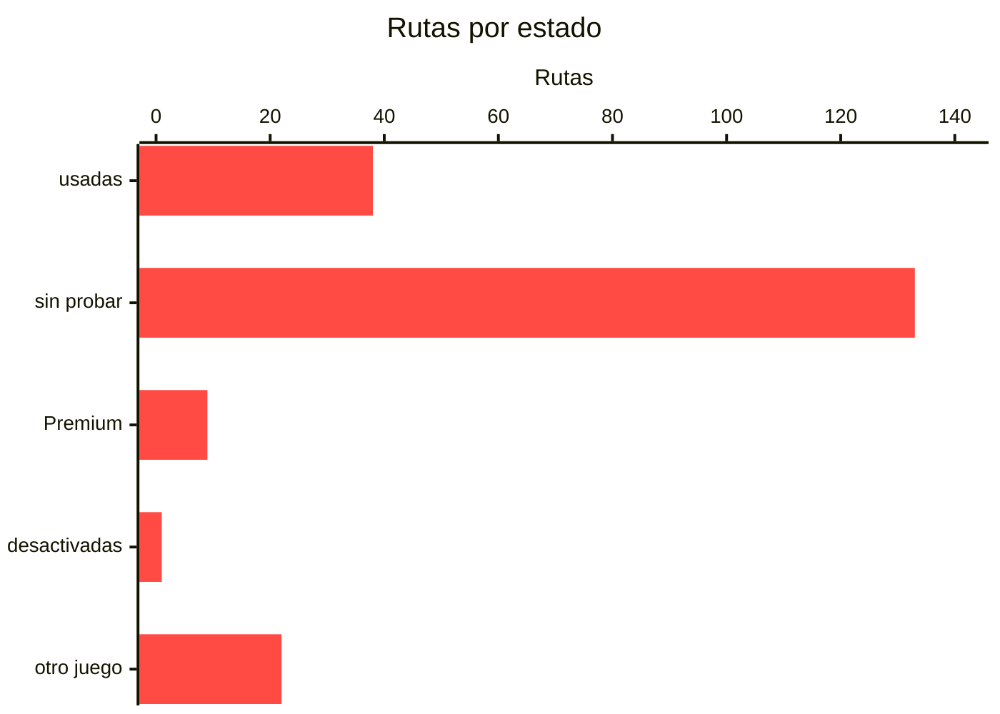

# Endpoints de LaLiga Fantasy

LaLiga Fantasy **no publica documentación de su API**. Este catálogo reúne las rutas conocidas, con la base `https://fantasy-api.llt-services.com`, y dice de cada una en qué estado está: usada y verificada, conocida pero sin probar, o dependiente de una función Premium que no se puede comprobar sin tenerla.

> [!WARNING]
> Es un catálogo de **rutas**, no un contrato. La API puede cambiar sin aviso, y lo hace a mitad de temporada. Lo marcado como verificado lo está **a la fecha en que se generó este documento**.

## Cómo leerlo

| estado | qué significa |
|---|---|
| **`[usada]`** | la usa este proyecto, así que está verificada contra la API real |
| `[sin probar]` | **el código de este proyecto no la llama.** El estado se deduce de `src/`, así que una ruta sondeada a mano sale igual que una que nadie ha tocado: si se probó, lo dice su descripción |
| **`[desactivada]`** | verificada y funciona, pero este proyecto decide no usarla |
| **`[premium]`** | depende de una función de pago. Sin ella responde `400 This feature is not enabled at your league` |
| `[otro juego]` | pertenece al Fantasy «clásico», que es otro producto |

## Cabeceras

```http
Authorization: Bearer <id_token>
x-lang: es
x-app: 2
```

El *bearer* es el **`id_token`**, no el `access_token`. La autenticación va por Azure AD B2C con Authorization Code y PKCE; el proceso completo está en [INSTALACION.md](INSTALACION.md#-conectar-tu-cuenta-de-laliga).

## Espacios de API

No hay uno solo. Conviven `/api/v1`, que es el grueso, `/api/v2` a `/api/v5`, `/stats/v1`, `/classic/v1` (el Fantasy clásico, otro juego) y `/dsp/v*` (contenido editorial, con su propio token de invitado).

## Cómo averiguar el verbo de una ruta

El catálogo recoge rutas; el método HTTP hay que averiguarlo. Un `GET` a secas lo resuelve casi siempre:

| respuesta | qué significa |
|---|---|
| `200` | es una lectura, y ya tienes el cuerpo |
| **`405`** | **la ruta existe, pero con otro verbo** |
| `404` | no existe, o no para tu liga |
| `400` con `errorCode` | existe y le faltan campos: el mensaje dice cuáles |

Ese `400` es el más útil: mandando el cuerpo incompleto a propósito, la API enumera lo que falta **sin ejecutar nada**.

> [!TIP]
> En las rutas que quitan algo, `/cancel` y `/delete` responden a **DELETE**; las que actúan (`/accept`, `/reject`, `/bid`, `/pay`) responden a **POST**.


---

**203 rutas**: 38 usadas y verificadas, 133 sin probar, 9 dependientes de Premium, 1 desactivada a propósito y 22 de otro juego.




## 🎁 Recompensas y blindaje (6)

| ruta | estado | qué hace |
|---|---|---|
| `/api/v1/competition/{competitionId}/league/{leagueId}/shield/player` | **[usada]** | blinda a un jugador propio contra el clausulazo |
| `/api/v1/competition/{competitionId}/league/{leagueId}/team/daily-reward` | **[usada]** | cobra la recompensa diaria |
| `/api/v1/competition/{competitionId}/daily-reward` | [sin probar] | la tarifa de la recompensa, no el cobro. Solo acepta GET |
| `/api/v1/competition/{competitionId}/league/{leagueId}/team/{teamId}/check-daily-reward` | [sin probar] | dice si la recompensa de hoy ya se cobró. **Solo el equipo propio: con id ajeno, 403** |
| `/api/v1/competition/{competitionId}/team/{teamId}/rewards` | [sin probar] |  |
| `/api/v1/competition/{competitionId}/team/{teamId}/rewards/collect-all` | [sin probar] |  |

## 💰 Mercado y fichajes (19)

| ruta | estado | qué hace |
|---|---|---|
| `/api/v1/competition/{competitionId}/league/{leagueId}/buyout/player` | **[usada]** | sube la cláusula de un jugador propio |
| `/api/v1/competition/{competitionId}/league/{leagueId}/buyout/{playerTeamId}/pay` | **[usada]** | paga una cláusula. Exige el importe EXACTO al euro |
| `/api/v1/competition/{competitionId}/league/{leagueId}/market` | **[usada]** | el mercado. `discr` separa agente libre de venta de otro manager |
| `/api/v1/competition/{competitionId}/league/{leagueId}/market/history` | **[usada]** | las últimas 30 operaciones de la liga, con importe |
| `/api/v1/competition/{competitionId}/league/{leagueId}/market/immediate-sale` | **[usada]** | venta instantánea. Paga el 50 % del valor, truncado al euro |
| `/api/v1/competition/{competitionId}/league/{leagueId}/market/sell` | **[usada]** | lista a un jugador propio en el mercado |
| `/api/v1/competition/{competitionId}/league/{leagueId}/market/{playerMarketId}/bid` | **[usada]** | puja por un agente libre. Se resuelve al cerrar el ciclo del mercado |
| `/api/v1/competition/{competitionId}/league/{leagueId}/market/{playerMarketId}/bid/{bidId}` | **[usada]** |  |
| `/api/v1/competition/{competitionId}/league/{leagueId}/market/{playerMarketId}/bid/{bidId}/cancel` | **[usada]** |  |
| `/api/v1/competition/{competitionId}/league/{leagueId}/market/{playerMarketId}/delete` | **[usada]** |  |
| `/api/v1/competition/{competitionId}/league/{leagueId}/market/{playerMarketId}/offer/{offerId}/accept` | **[usada]** |  |
| `/api/v1/competition/{competitionId}/league/{leagueId}/market/{playerMarketId}/offer/{offerId}/cancel` | **[usada]** |  |
| `/api/v1/competition/{competitionId}/league/{leagueId}/market/{playerMarketId}/offer/{offerId}/reject` | **[usada]** |  |
| `/api/v1/competition/{competitionId}/league/{leagueId}/playerTeam/{playerTeamId}/offer` | **[usada]** |  |
| `/api/v1/competition/{competitionId}/player/{playerMasterId}/market-value` | **[usada]** | histórico oficial de precios, más largo que el que acumules tú |
| `/api/v1/competition/{competitionId}/league/{leagueId}/market/direct-offer` | **[desactivada]** | funciona, pero comprar a otro manager está desactivado a propósito: el dueño decide, la oferta revela por dónde vas flojo y el dinero acaba en un rival |
| `/api/v1/competition/{competitionId}/league/{leagueId}/buyout/{playerTeamId}` | [sin probar] |  |
| `/api/v1/competition/{competitionId}/league/{leagueId}/market/{playerMarketId}/offer` | [sin probar] |  |
| `/api/v1/competition/{competitionId}/league/{leagueId}/market/{playerMarketId}/offer/{offerId}` | [sin probar] |  |

## ⚽ Equipo, alineación y jugadores (29)

| ruta | estado | qué hace |
|---|---|---|
| `/api/v1/competition/{competitionId}/league/{leagueId}/player-team/{playerTeamId}/check-shield` | **[usada]** | pregunta si se puede blindar ahora, sin gastar nada |
| `/api/v1/competition/{competitionId}/leagues/{leagueId}/teams/{teamId}` | **[usada]** | plantilla de un equipo, con cláusulas y blindajes |
| `/api/v1/competition/{competitionId}/player/{playerMasterId}` | **[usada]** |  |
| `/api/v1/competition/{competitionId}/player/{playerMasterId}/league/{leagueId}` | **[usada]** | ficha completa: puntos por jornada y concepto, dueño y cláusula |
| `/api/v1/competition/{competitionId}/players` | **[usada]** | maestro de jugadores. PÚBLICO: responde sin token y con caché de 8 h |
| `/api/v1/competition/{competitionId}/players/live-points` | **[usada]** | puntos en vivo. Devuelve lista vacía si no hay partido rodando |
| `/api/v1/competition/{competitionId}/profitable/{weekNumber}` | **[usada]** | el once más rentable de la jornada, en puntos por millón |
| `/api/v1/competition/{competitionId}/teams/{teamId}` | **[usada]** |  |
| `/api/v1/competition/{competitionId}/teams/{teamId}/lineup` | **[usada]** | alineación actual, la de la PRÓXIMA jornada |
| `/api/v1/competition/{competitionId}/teams/{teamId}/lineup/week/{weekNumber}` | **[usada]** | el once CONGELADO de esa jornada, que es el que puntuó |
| `/api/v1/competition/{competitionId}/teams/{teamId}/money` | **[usada]** | `teamMoney` y `teamInvestment`. El disponible real es la resta. **Solo sirve para el equipo propio: con el id de otro manager responde 403** |
| `/api/v1/competition/{competitionId}/league/{leagueId}/playerTeam/{playerTeamId}/loan` | **[premium]** | necesita Premium (cesiones) |
| `/api/v1/competition/{competitionId}/league/{leagueId}/playerTeam/{playerTeamId}/return-loan` | **[premium]** | necesita Premium (cesiones) |
| `/api/v4/teams/lineup/formations` | **[premium]** | necesita Premium (más formaciones) |
| `/api/v1/competition/{competitionId}/league/{leagueId}/playerTeam/{playerTeamId}/reject-all-offers` | [sin probar] |  |
| `/api/v1/competition/{competitionId}/players/league/{leagueId}` | [sin probar] |  |
| `/api/v1/competition/{competitionId}/teams/{teamId}/favourite-players` | [sin probar] | los jugadores que sigues. El propio devuelve una lista; **con id ajeno, 403** |
| `/api/v1/competition/{competitionId}/teams/{teamId}/report/new` | [sin probar] |  |
| `/api/v1/competition/{competitionId}/teams/{teamId}/report/resolve` | [sin probar] |  |
| `/classic/v1/competition/{competitionId}/teams/{teamId}` | [otro juego] |  |
| `/classic/v1/competition/{competitionId}/teams/{teamId}/activity` | [otro juego] |  |
| `/classic/v1/competition/{competitionId}/teams/{teamId}/buy` | [otro juego] |  |
| `/classic/v1/competition/{competitionId}/teams/{teamId}/favourite-players` | [otro juego] | los jugadores que sigues. El propio devuelve una lista; **con id ajeno, 403** |
| `/classic/v1/competition/{competitionId}/teams/{teamId}/favourite-players/{playerMasterId}` | [otro juego] |  |
| `/classic/v1/competition/{competitionId}/teams/{teamId}/lineUp` | [otro juego] |  |
| `/classic/v1/competition/{competitionId}/teams/{teamId}/lineUp/recover` | [otro juego] |  |
| `/classic/v1/competition/{competitionId}/teams/{teamId}/ranking` | [otro juego] |  |
| `/classic/v1/competition/{competitionId}/teams/{teamId}/sell` | [otro juego] |  |
| `/classic/v1/competition/{competitionId}/teams/{teamId}/tactical-formation` | [otro juego] |  |

## 🏆 Ligas, clasificación y ranking (34)

| ruta | estado | qué hace |
|---|---|---|
| `/api/v1/competition/{competitionId}/leagues` | **[usada]** | tus ligas y, en cada una, qué funciones Premium tiene activas |
| `/api/v1/competition/{competitionId}/leagues/{leagueId}` | **[usada]** |  |
| `/api/v1/competition/{competitionId}/leagues/{leagueId}/activity/{page}` | **[usada]** |  |
| `/api/v1/competition/{competitionId}/leagues/{leagueId}/standing` | **[usada]** | clasificación de la liga |
| `/api/v1/competition/{competitionId}/leagues/{leagueId}/standing/{weekNumber}` | **[usada]** |  |
| `/api/v1/competition/{competitionId}/leagues/{leagueId}/teams` | **[usada]** | los equipos de la liga con sus puntos de la jornada en curso |
| `/api/v1/competition/{competitionId}/league/{leagueId}/loan` | **[premium]** | necesita Premium (cesiones) |
| `/api/v1/competition/{competitionId}/league/{leagueId}/loan/{loanOfferId}` | **[premium]** | necesita Premium (cesiones) |
| `/api/v1/competition/{competitionId}/league/{leagueId}/loan/{loanOfferId}/accept` | **[premium]** | necesita Premium (cesiones) |
| `/api/v1/competition/{competitionId}/league/{leagueId}/loan/{loanOfferId}/cancel` | **[premium]** | necesita Premium (cesiones) |
| `/api/v1/competition/{competitionId}/league/{leagueId}/loan/{loanOfferId}/reject` | **[premium]** | necesita Premium (cesiones) |
| `/api/v1/competition/{competitionId}/league-type/token/{leagueToken}` | [sin probar] |  |
| `/api/v1/competition/{competitionId}/league/{leagueId}/user-consumable` | [sin probar] |  |
| `/api/v1/competition/{competitionId}/leagues-public/{sponsorId}/me` | [sin probar] |  |
| `/api/v1/competition/{competitionId}/leagues-types` | [sin probar] |  |
| `/api/v1/competition/{competitionId}/leagues/last-season` | [sin probar] |  |
| `/api/v1/competition/{competitionId}/leagues/{leagueId}/archive` | [sin probar] |  |
| `/api/v1/competition/{competitionId}/leagues/{leagueId}/keep` | [sin probar] |  |
| `/api/v1/competition/{competitionId}/leagues/{leagueId}/me` | [sin probar] |  |
| `/api/v1/competition/{competitionId}/leagues/{leagueId}/upgrade` | [sin probar] |  |
| `/api/v1/competition/{competitionId}/leagues/{leagueToken}/users/me` | [sin probar] |  |
| `/api/v1/competition/{competitionId}/ranking/global` | [sin probar] | los 100 primeros del mundo |
| `/api/v1/competition/{competitionId}/ranking/global/month/{month}` | [sin probar] |  |
| `/api/v1/competition/{competitionId}/ranking/global/week/{weekNumber}` | [sin probar] |  |
| `/api/v1/competition/{competitionId}/ranking/week/{weekNumber}/global` | [sin probar] |  |
| `/api/v1/competition/{competitionId}/ranking/week/{weekNumber}/{sponsorId}` | [sin probar] |  |
| `/api/v1/competition/{competitionId}/ranking/{sponsorId}` | [sin probar] |  |
| `/api/v1/competition/{competitionId}/ranking/{sponsorId}/month/{month}` | [sin probar] |  |
| `/api/v3/leagues/{leagueId}/duplicate` | [sin probar] |  |
| `/api/v4/leagues/configuration` | [sin probar] |  |
| `/api/v4/leagues/premium-configuration` | [sin probar] |  |
| `/classic/v1/competition/{competitionId}/league-definitions` | [otro juego] |  |
| `/classic/v1/competition/{competitionId}/league-definitions/{leagueDefinitionId}/ranking` | [otro juego] |  |
| `/classic/v1/competition/{competitionId}/sponsored-leagues/{sponsoredLeagueId}/ranking` | [otro juego] |  |

## 📅 Jornada y calendario (4)

| ruta | estado | qué hace |
|---|---|---|
| `/api/v1/competition/{competitionId}/calendar` | **[usada]** | los 10 partidos de una jornada, con fecha y estado |
| `/api/v1/competition/{competitionId}/week/current` | **[usada]** | jornada, si está en juego y sus fechas de apertura y cierre |
| `/api/v1/competition/{competitionId}/ideal/{weekNumber}` | **[premium]** | necesita Premium (once ideal) |
| `/api/v1/competition/{competitionId}/seasons/last` | [sin probar] | temporada actual y anterior, con sus fechas |

## 👤 Usuario y sesión (21)

| ruta | estado | qué hace |
|---|---|---|
| `/api/v4/user/me` | **[usada]** |  |
| `/api/v1/fan/CheckAlias` | [sin probar] |  |
| `/api/v1/fan/me` | [sin probar] |  |
| `/api/v1/fan/me/Avatar` | [sin probar] |  |
| `/api/v1/fan/me/Preferences/Teams` | [sin probar] |  |
| `/api/v1/fan/me/Preferences/Teams/All/Football` | [sin probar] |  |
| `/api/v1/fan/me/anonymize` | [sin probar] |  |
| `/api/v1/fan/me/consents` | [sin probar] |  |
| `/api/v1/fan/me/policies` | [sin probar] |  |
| `/api/v1/fan/me/updatealias` | [sin probar] |  |
| `/api/v1/guests/{idGuest}/Apps/{appId}/{deviceId}` | [sin probar] |  |
| `/api/v1/purchases/user` | [sin probar] |  |
| `/api/v1/user-consumable` | [sin probar] |  |
| `/api/v1/user-consumable/historic` | [sin probar] |  |
| `/api/v1/user-notifications` | [sin probar] |  |
| `/api/v1/useractions` | [sin probar] |  |
| `/api/v2/guests` | [sin probar] |  |
| `/api/v3/user/region-by-country` | [sin probar] |  |
| `/api/v3/user/region/{regionId}` | [sin probar] |  |
| `/v1/fan/me/configuration/{clientId}/{sponsorRequirement}` | [sin probar] |  |
| `/dsp/v3/token` | [otro juego] |  |

## 🔔 Notificaciones (2)

| ruta | estado | qué hace |
|---|---|---|
| `/api/v1/competition/{competitionId}/notifications` | [sin probar] |  |
| `/api/v1/competition/{competitionId}/notifications/subscriptions` | [sin probar] |  |

## 📊 Estadísticas (/stats/v1) (5)

| ruta | estado | qué hace |
|---|---|---|
| `/stats/v1/competition/{competitionId}/market/evolution/month` | [sin probar] | del espacio `/stats/v1`, que responde **404** en todo lo probado |
| `/stats/v1/competition/{competitionId}/market/evolution/season` | [sin probar] | del espacio `/stats/v1`, que responde **404** en todo lo probado |
| `/stats/v1/competition/{competitionId}/market/evolution/week` | [sin probar] | del espacio `/stats/v1`, que responde **404** en todo lo probado |
| `/stats/v1/competition/{competitionId}/players/status` | [sin probar] | del espacio `/stats/v1`, que responde **404** en todo lo probado |
| `/stats/v1/competition/{competitionId}/stats/week/{week}` | [sin probar] | del espacio `/stats/v1`, que responde **404** en todo lo probado |

## 🃏 Fantasy Classic: es otro juego (6)

| ruta | estado | qué hace |
|---|---|---|
| `/classic/v1/competition/{competitionId}/carousel-card` | [otro juego] |  |
| `/classic/v1/competition/{competitionId}/fixture-player-values` | [otro juego] |  |
| `/classic/v1/competition/{competitionId}/fixture-player-values/{playerMasterId}` | [otro juego] |  |
| `/classic/v1/competition/{competitionId}/sponsored-leagues` | [otro juego] |  |
| `/classic/v1/competition/{competitionId}/teams` | [otro juego] |  |
| `/classic/v3/news` | [otro juego] |  |

## 🧱 Infraestructura de la app (no aplica aquí) (33)

| ruta | estado | qué hace |
|---|---|---|
| `/api/v1/competition/{competitionId}/config` | **[usada]** | configuración de la competición, incluidas las jornadas ya arrancadas |
| `/api/v1/android/validate_purchase` | [sin probar] |  |
| `/api/v1/android/validate_purchase_v2` | [sin probar] |  |
| `/api/v1/countries` | [sin probar] |  |
| `/api/v1/deeplinks/active` | [sin probar] |  |
| `/api/v1/deeplinks/purchasing` | [sin probar] |  |
| `/api/v1/deeplinks/validate` | [sin probar] |  |
| `/api/v1/products` | [sin probar] |  |
| `/api/v1/purchases/notify/android` | [sin probar] |  |
| `/api/v1/sponsors` | [sin probar] |  |
| `/api/v2/android/validate_subscription` | [sin probar] |  |
| `/api/v2/android/validate_subscription_v2` | [sin probar] |  |
| `/api/v2/help_center` | [sin probar] |  |
| `/api/v2/help_center/articles/search` | [sin probar] |  |
| `/api/v2/help_center/articles/{article_id}/down` | [sin probar] |  |
| `/api/v2/help_center/articles/{article_id}/up` | [sin probar] |  |
| `/api/v2/help_center/votes/` | [sin probar] |  |
| `/api/v2/help_center/votes/{vote_id}` | [sin probar] |  |
| `/api/v2/help_center/{locale}/articles` | [sin probar] |  |
| `/api/v2/help_center/{locale}/articles/{article_id}/attachments/{attachment_type}` | [sin probar] |  |
| `/api/v2/help_center/{locale}/articles/{article_id}/stats/view` | [sin probar] |  |
| `/api/v2/help_center/{locale}/categories` | [sin probar] |  |
| `/api/v2/help_center/{locale}/categories/{category_id}` | [sin probar] |  |
| `/api/v2/help_center/{locale}/categories/{id}/sections` | [sin probar] |  |
| `/api/v2/help_center/{locale}/sections/{id}/articles` | [sin probar] |  |
| `/api/v2/help_center/{locale}/sections/{section_id}` | [sin probar] |  |
| `/api/v3/sponsor/{sponsorId}/checks/set` | [sin probar] |  |
| `/api/v4/sponsor/broadcaster/checks` | [sin probar] |  |
| `/api/v4/sponsor/{sponsorId}/checks` | [sin probar] |  |
| `/v1/purchases/consume/android` | [sin probar] |  |
| `/v1/purchases/refund/request/android` | [sin probar] |  |
| `/dsp/v1/consents` | [otro juego] |  |
| `/dsp/v2/policies/{clientId}` | [otro juego] |  |

## ❔ Sin clasificar (44)

| ruta | estado | qué hace |
|---|---|---|
| `/api/v1/competitions` | [sin probar] |  |
| `/api/v2/generic/v6` | [sin probar] |  |
| `/api/v2/ticket_forms/show_many` | [sin probar] |  |
| `/api/v3/teams-master` | [sin probar] |  |
| `/api/v3/time` | [sin probar] |  |
| `/api/v4/modal-info` | [sin probar] |  |
| `/api/v4/regions` | [sin probar] |  |
| `/api/v5/activity-types` | [sin probar] |  |
| `/api/v5/languages` | [sin probar] |  |
| `/v1/XmlPullParser` | [sin probar] |  |
| `/v1/XmlPullParserException` | [sin probar] |  |
| `/v1/XmlPullParserFactory` | [sin probar] |  |
| `/v1/XmlSerializer` | [sin probar] |  |
| `/v1/banner` | [sin probar] |  |
| `/v1/preferences` | [sin probar] |  |
| `/v1/projects/` | [sin probar] |  |
| `/v1/save-log-consent` | [sin probar] |  |
| `/v1/uc-purposes` | [sin probar] |  |
| `/v1/vendors` | [sin probar] |  |
| `/v2/applicationdata` | [sin probar] |  |
| `/v2/c` | [sin probar] |  |
| `/v2/n` | [sin probar] |  |
| `/v2/platforms/android/gmp/` | [sin probar] |  |
| `/v3/mraid_app_banner` | [sin probar] |  |
| `/v3/mraid_app_expanded_banner` | [sin probar] |  |
| `/v3/mraid_app_interstitial` | [sin probar] |  |
| `/v4/app/RemoteActionCompatParcelizer` | [sin probar] |  |
| `/v4/graphics/drawable/IconCompatParcelizer` | [sin probar] |  |
| `/v4/media/AudioAttributesCompatParcelizer` | [sin probar] |  |
| `/v4/media/AudioAttributesImplApi21Parcelizer` | [sin probar] |  |
| `/v4/media/AudioAttributesImplApi26Parcelizer` | [sin probar] |  |
| `/v4/media/AudioAttributesImplBaseParcelizer` | [sin probar] |  |
| `/v4/media/MediaBrowserCompat` | [sin probar] |  |
| `/v4/media/MediaDescriptionCompat` | [sin probar] |  |
| `/v4/media/MediaMetadataCompat` | [sin probar] |  |
| `/v4/media/RatingCompat` | [sin probar] |  |
| `/v4/media/session/MediaControllerCompat` | [sin probar] |  |
| `/v4/media/session/MediaSessionCompat` | [sin probar] |  |
| `/v4/media/session/ParcelableVolumeInfo` | [sin probar] |  |
| `/v4/media/session/PlaybackStateCompat` | [sin probar] |  |
| `/v4/media/session/a` | [sin probar] |  |
| `/v4/media/session/b` | [sin probar] |  |
| `/v4/media/session/c` | [sin probar] |  |
| `/v4/media/session/d` | [sin probar] |  |

## Rutas que NO existen

Comprobadas y descartadas, para no volver a sondearlas.

| ruta | respuesta |
|---|---|
| `/api/v1/competition/{competitionId}/news` | 404 |
| `/api/v1/competition/{competitionId}/rewards` | 404 |
| `/api/v1/competition/{competitionId}/week/{weekNumber}/ideal-formation` | 404 |
| `/api/v4/daily-reward` | 404 |
| `/stats/v1/…` | todo lo probado de este espacio responde 404 |
