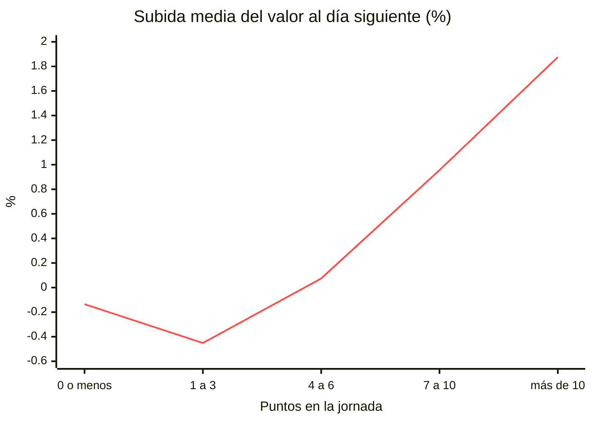
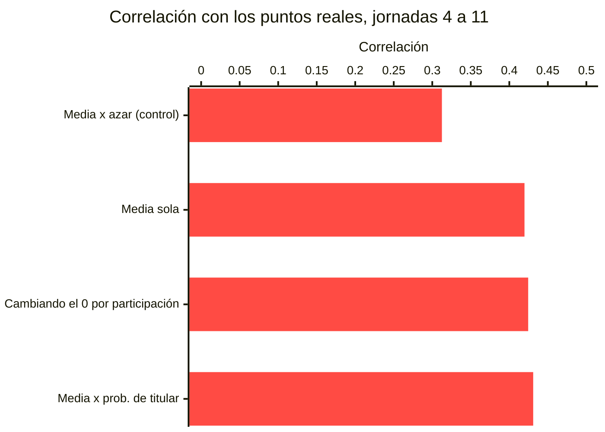

# Dónde está la ventaja

En una liga donde todos leen las mismas fuentes, la ventaja no está en tener los datos. Está en **recoger los datos que a los demás les da pereza recoger** y en **actuar antes**.

Este documento recoge qué señales se han medido de verdad, con qué método y con qué resultado. Cada cifra lleva su muestra, y las que no aguantaron la medición están en [lo que no aporta](#lo-que-se-midió-y-no-aporta).

> [!NOTE]
> **Cómo se mide aquí.** Para cada jornada se predice con lo conocido **antes** de que se juegue, se compara con lo que pasó y se pone siempre al lado un **control al azar**. Una señal que no bate al azar no se usa, por razonable que parezca. Tres señales «obvias» seguidas no superaron esa prueba.

---

## 1. El precio, no los puntos

El valor de mercado se recalcula a diario y refleja a la comunidad entera del juego, no a tu liga. Eso lo hace atacable:

- **Tiene inercia.** Lo que sube hoy tiende a seguir subiendo mañana.
- **No depende del rendimiento.** Comprar a 2 M un jugador que pasa a valer 3 M es dinero sin riesgo deportivo.
- **Se convierte en poder.** Más presupuesto es más margen para clausular, y en una liga con cláusulas ese es el bucle que gana.

### El momentum, validado contra una temporada entera

Sobre la temporada 24/25 completa, con **197.041 observaciones** de 1.189 jugadores en 326 días evaluables:

| | rendimiento diario |
|---|---|
| Los 50 que más subieron ayer | **+2,36 %** |
| El jugador medio | −0,12 % |
| **Ventaja** | **+2,47 puntos porcentuales al día** |
| Días en que la cartera bate a la media | **322 de 326** |

> [!WARNING]
> **La señal es fuerte; las ocasiones, pocas.** Solo se pueden comprar con seguridad los agentes libres, y el mercado libre trae sobre todo lo que nadie quiere: de 104 fichas medidas, el 56,7 % salía bajando y solo el 10,6 % subiendo. Son unas 1,5 ocasiones por semana.

Un modelo de mínimos cuadrados con 8 variables (retornos a 1, 3 y 7 días, aceleración, volatilidad…) **no bate a la inercia**: gana 0 de 8 días evaluados. Se usa la señal simple.

### Puntuar mueve el precio, y antes que el momentum

Los puntos de una jornada se conocen **en cuanto acaba el partido**, y el precio no se recalcula hasta el día siguiente. Medido sobre 72.958 observaciones de la 24/25:

| puntos en la jornada | 0 o menos | 1 a 3 | 4 a 6 | 7 a 10 | más de 10 |
|---|:---:|:---:|:---:|:---:|:---:|
| subida al día siguiente | −0,14 % | **−0,45 %** | +0,07 % | +0,96 % | **+1,88 %** |

- **Más de 10 puntos frente a no puntuar: +2,01 puntos porcentuales** al día siguiente, y el efecto sigue a 3 y a 5 días.
- **Hacer 1 a 3 puntos es peor que no jugar** (−0,45 % frente a −0,14 %). El algoritmo castiga más rendir mal que no jugar: comprar a quien acaba de firmar una jornada floja rinde peor que comprar a un suplente.

### Los parones de selecciones

Durante un parón no hay puntos, pero el mercado sigue vivo. La hipótesis era que el miedo a lesiones y rotaciones abarata a los jugadores. **Se cumple, pero es pequeño**: el jugador medio pierde −0,26 % al día durante el parón frente a −0,10 % el resto del año. Un parón de ocho días acumula alrededor de −1,3 %. Con 27 días de muestra, es un indicio, no un plan.

### El precio no solo cambia a medianoche

El recálculo principal es de madrugada, pero **el 58 % de los jugadores cambia de valor más de una vez al día**. Lo que sí está quieto es la tarde: entre las 14 h y las 20 h el valor medio se mueve un +0,04 %. Decidir por la tarde es decidir sobre el número que va a estar vigente; decidir a primera hora es decidir sobre uno que va a cambiar.

---

## 2. Las ventanas de clausulazo tienen horario

Las dos protecciones del juego vencen a una hora conocida: los **14 días** del recién fichado y las **24 horas** del blindaje. Eso convierte el clausulazo en una agenda que se puede calcular para la liga entera.

- **Las liberaciones son el mejor caladero.** Un fichaje reciente entra con la cláusula pegada a lo que se pagó, y sus 14 días lo esconden justo mientras está más barato en proporción. Quien solo mira los clausulables de hoy no ve nunca a los más baratos.
- **Al revés, también te pasa a ti.** La cláusula no sube sola cuando sube el valor del jugador, así que un buen fichaje tuyo queda expuesto barato hasta que la subas a mano.
- **El blindaje es un recurso puntual, no una cobertura.** Son dos por jornada de 24 horas, y la ventana de clausulazos puede durar días. La pregunta no es cómo mantenerlo puesto sino en qué tramo gastarlo.

> [!TIP]
> Al elegir a quién blindar cuentan dos filtros antes que el ratio cláusula/valor: **quién puede pagarlo**, porque blindar a alguien que ningún rival alcanza tira medio cupo, y **cuánto cae tu once sin él**, medido rehaciendo el mejor once y no restando su suplente.

---

## 3. Los rivales se pueden modelar

En una liga con pocos participantes el problema deja de ser estadístico: cada rival se puede seguir por separado. Del tablón público se saca:

| | para qué |
|---|---|
| **Caja estimada** | Por partida doble sobre compras, ventas, clausulazos y recompensas. Dice a quién le alcanza para clausularte |
| **Sobrepuja habitual** | Cuánto paga por encima del valor; predice su puja en una subasta ciega |
| **A quién blinda** | Blindar cuesta un cupo escaso, así que señala justo al jugador que teme perder |
| **Cuándo opera** | Las ventas y los clausulazos salen en el tablón con su hora |

**La caja estimada está validada contra cifras que dieron los propios rivales**: tres contrastes, con errores del 2,0 %, el 9,9 % y el 0,7 %. Es una **cota superior**, porque las subidas de cláusula ajenas no salen en el tablón: el saldo real es igual o menor, nunca mayor.

> [!IMPORTANT]
> **Una caja estimada de hace horas no es una estimación.** Un rival puede multiplicar su saldo por doce con una sola venta, y otro puede cobrar cien millones de un clausulazo entre rivales y atacar en el acto. Antes de decidir sobre la caja de alguien, se refresca el tablón.

**Y una oferta es información pública.** Ofertar por la posición en la que vas flojo le dice a todos dónde estás débil, y los demás pueden cerrar las alternativas antes de que llegues. El mercado libre, en cambio, es ciego hasta que la subasta se resuelve.

---

## 4. Los onces probables, como dato y no como verdad

La probabilidad de ser titular de [futbolfantasy](https://www.futbolfantasy.com/) **sí aporta**. Predecir los puntos con la media previa del jugador:

Son 3.219 casos y lo repite `scripts/medir_prob_titular.py`. La mejora es pequeña pero estable, y un 0 de la fuente se respeta: es el tramo con menos puntuadores, y sustituirlo por la participación empeora la predicción.

Dos cautelas que salen de usarlo:

- **Un scrapeo recién acabado el partido es el once de ese partido**, no una predicción: valores de 0 o 1 para quien acaba de jugar. Se corrige solo en el siguiente scrapeo.
- **Un 0 que contradice a los minutos jugados se comprueba.** Un portero con 90 minutos en ocho jornadas seguidas y probabilidad 0 es un fallo del dato, no un suplente.

---

## 5. La temporada pasada predice mejor que la actual

Contra lo que parece intuitivo, con pocas jornadas jugadas **los puntos de la temporada anterior predicen mejor que el ritmo de esta**. Medido sobre 761 predicciones:

| señal | correlación con los puntos reales |
|---|---|
| Solo la temporada pasada | +0,3995 |
| Solo el ritmo de esta temporada | +0,3302 |
| **Mezcla de las dos** | **+0,4409** |

La mezcla da más peso al ritmo actual a medida que avanzan las jornadas, y es lo que usa el modelo del once. Para los jugadores sin temporada anterior, el sustituto se ajustó con el mismo método: una curva sobre el valor de mercado con tope, que bate a la media constante (error medio 37,4 frente a 49,6 puntos).

---

## 6. Backtesting desde el primer día

Toda predicción se guarda en `predictions` con su contexto y se liquida después contra lo que pasó. Con 38 jornadas y pocos participantes la varianza es enorme: **sin backtesting no hay forma de distinguir un sistema bueno de una racha**.

> [!CAUTION]
> **Un acierto del 100 % es una alarma, no un éxito.** La primera métrica de precio daba 1,000 de acierto, y la inercia también: el 38,6 % de los días el valor no cambia, y contar ese empate como «no sube» regala aciertos. Toda métrica nueva necesita una referencia tonta al lado.

---

## 7. Pendiente: las cuotas de apuestas

La probabilidad de portería a cero que se deduce de las cuotas es la mejor fuente pública **calibrada** que existe: las casas de apuestas se juegan dinero en acertarla. Para porteros y defensas es el mayor bloque de puntos de la tabla.

Hoy solo hay una aproximación sin calibrar, a partir del ataque del rival. Las cuotas reales están **pendientes de integrar**, y cuando lo estén se medirán con el mismo método antes de entrar en el once.

---

## Lo que se midió y no aporta

| idea | resultado | por qué |
|---|---|---|
| **Ajustar por la dificultad del rival** | **Empeora**: 0,4111 frente a 0,4266 sin ajustar, y un factor al azar da 0,4359 | Los puntos de LaLiga ya incluyen goles y porterías a cero, así que el efecto del rival ya está en la media del jugador. Aplicarlo otra vez es contarlo dos veces |
| **Descontar a los traspasados** su temporada anterior | Igual que penalizar al azar: +0,0003 | Con tres o cuatro jornadas, el ritmo actual ya refleja el equipo nuevo |
| **Bajar el peso de la temporada pasada** | El valor actual ya está en el óptimo; el siguiente mejora +0,0011, que es ruido | |
| **Modelo de precio de 8 variables** | Gana 0 de 8 días a la inercia | Es una forma cara de decir «compra lo que sube» |

## Lo que no se hace, y por qué

- **Un modelo de puntos de extremo a extremo.** Unos 800 jugadores por 38 jornadas es poco dato para tanta varianza. Descomponer en señales es interpretable y dice **por qué** se equivocó.
- **Un modelo de lenguaje local en el servidor.** Uno que quepa en una máquina pequeña razona peor que unas reglas de negocio bien escritas.
- **Pedir datos más deprisa.** El límite real no es técnico: es que cierren la cuenta a mitad de temporada. El histórico ya está en la base de datos.
